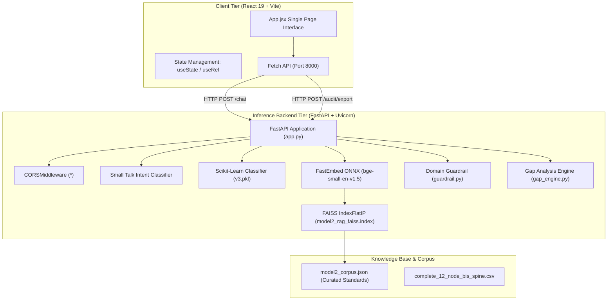

# Step 0 Pre-Check: Project Type Detection

## Project Classification: Track C / Hybrid (FastAPI Python Backend + React Vite SPA Frontend)

Based on an exhaustive scan of the repository root, package managers, lockfiles, and source files, this project is classified as:
**Hybrid Track C (Python FastAPI Backend + ML/RAG Engine) + Track B (React 19 Vite Single Page Application Frontend)**.

### Detection Evidence & File References

| Component | Technology Detected | Exact Version / Specifier | Evidence File & Line |
| :--- | :--- | :--- | :--- |
| **Backend Framework** | FastAPI | `fastapi==0.110.0` | [`requirements.txt:L4`](file:///Users/avishjain/avishjain9-repos/21-bis-compliance-engine/requirements.txt#L4), [`app.py:L5`](file:///Users/avishjain/avishjain9-repos/21-bis-compliance-engine/app.py#L5) |
| **ASGI Web Server** | Uvicorn | `uvicorn==0.28.0` | [`requirements.txt:L5`](file:///Users/avishjain/avishjain9-repos/21-bis-compliance-engine/requirements.txt#L5), [`Dockerfile:L15`](file:///Users/avishjain/avishjain9-repos/21-bis-compliance-engine/Dockerfile#L15) |
| **Data Validation** | Pydantic v2 | `pydantic==2.6.4` | [`requirements.txt:L6`](file:///Users/avishjain/avishjain9-repos/21-bis-compliance-engine/requirements.txt#L6), [`app.py:L8`](file:///Users/avishjain/avishjain9-repos/21-bis-compliance-engine/app.py#L8) |
| **Vector Search Engine** | FAISS CPU | `faiss-cpu==1.8.0` | [`requirements.txt:L2`](file:///Users/avishjain/avishjain9-repos/21-bis-compliance-engine/requirements.txt#L2), [`app.py:L4`](file:///Users/avishjain/avishjain9-repos/21-bis-compliance-engine/app.py#L4) |
| **Dense Embeddings** | FastEmbed (ONNX Runtime) | `fastembed>=0.5.0` (`BAAI/bge-small-en-v1.5`) | [`requirements.txt:L1`](file:///Users/avishjain/avishjain9-repos/21-bis-compliance-engine/requirements.txt#L1), [`app.py:L10`](file:///Users/avishjain/avishjain9-repos/21-bis-compliance-engine/app.py#L10) |
| **Supervised Classifier** | Scikit-Learn | `scikit-learn==1.4.1.post1` (`joblib` model) | [`requirements.txt:L3`](file:///Users/avishjain/avishjain9-repos/21-bis-compliance-engine/requirements.txt#L3), [`app.py:L3`](file:///Users/avishjain/avishjain9-repos/21-bis-compliance-engine/app.py#L3) |
| **Frontend Framework** | React 19 SPA | `react: ^19.2.8`, `react-dom: ^19.2.8` | [`bis-frontend/package.json:L15-L16`](file:///Users/avishjain/avishjain9-repos/21-bis-compliance-engine/bis-frontend/package.json#L15-L16) |
| **Frontend Bundler** | Vite 8 | `vite: ^8.3.0` | [`bis-frontend/package.json:L23`](file:///Users/avishjain/avishjain9-repos/21-bis-compliance-engine/bis-frontend/package.json#L23) |
| **Documentation Site** | VitePress | `vitepress: ^1.6.3` | [`package.json:L10`](file:///Users/avishjain/avishjain9-repos/21-bis-compliance-engine/package.json#L10) |
| **Containerization** | Docker (Debian 3.11-slim) | Python 3.11-slim, Port 10000 | [`Dockerfile:L1-L16`](file:///Users/avishjain/avishjain9-repos/21-bis-compliance-engine/Dockerfile#L1-L16) |

---

## Architectural Profile

### Adaptation Rules for This Project

1. **Non-MERN Backend Adaptation**: Instead of Node.js/Express and MongoDB, this codebase employs Python 3.11, FastAPI, Uvicorn, Scikit-Learn, and an in-memory vector index via FAISS (`IndexFlatIP`). The documentation adapts all server and database sections to evaluate this exact stack while providing thorough comparative benchmarks against Express and MongoDB.
2. **AI Integration Scope**: The system utilizes an **air-gapped, zero-cloud, 100% offline machine learning and vector retrieval architecture**. Rather than calling metered third-party cloud LLM APIs (such as OpenAI, Anthropic, or Google Gemini), it executes local ONNX embeddings (`BAAI/bge-small-en-v1.5` via FastEmbed) and a serialized Scikit-Learn department classifier (`bis_product_department_model_v3.pkl`). All AI sections document this offline RAG and inference pipeline with precision.
3. **Database Architecture**: Rather than an external networked DBMS (such as PostgreSQL or MongoDB), the project utilizes a high-performance in-memory inverted vector index (`faiss.IndexFlatIP`) coupled with a deterministic JSON master knowledge base (`model2_corpus.json`). Persistence and storage scaling are documented accordingly.
4. **No Placeholder / No Invented Code**: Every claim, workflow, and parameter matches the concrete implementations in [`app.py`](file:///Users/avishjain/avishjain9-repos/21-bis-compliance-engine/app.py), [`gap_engine.py`](file:///Users/avishjain/avishjain9-repos/21-bis-compliance-engine/gap_engine.py), [`guardrail.py`](file:///Users/avishjain/avishjain9-repos/21-bis-compliance-engine/guardrail.py), and [`bis-frontend/src/App.jsx`](file:///Users/avishjain/avishjain9-repos/21-bis-compliance-engine/bis-frontend/src/App.jsx).
