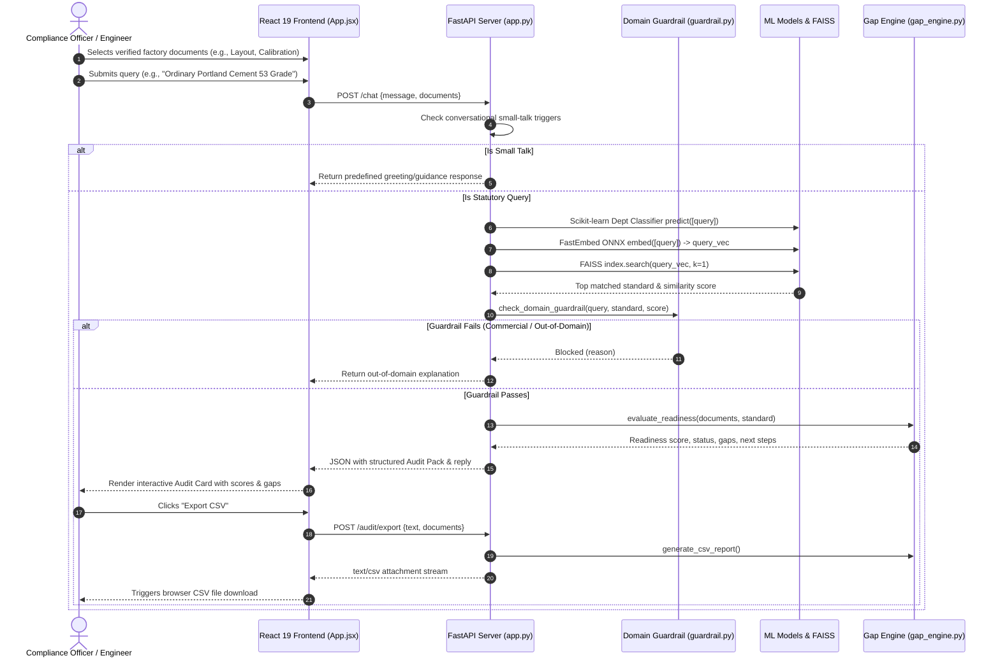
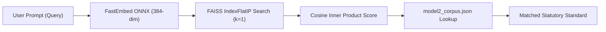
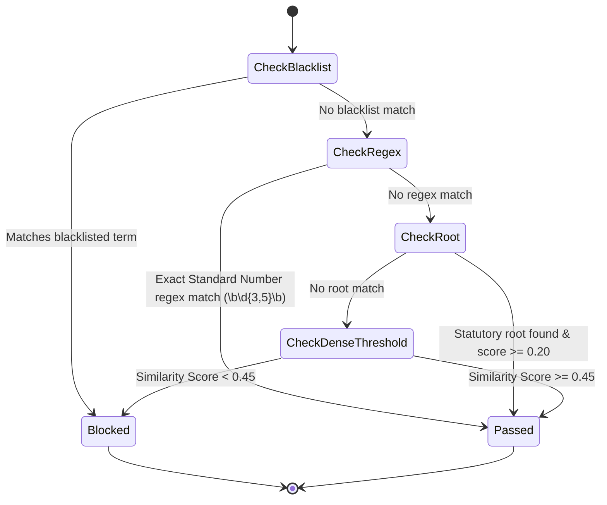
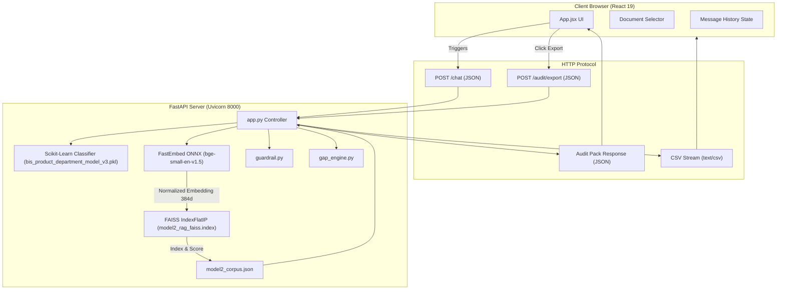

# Step 0: Full Project Analysis

## 0.1 What the Project Is

### Project Name & Purpose
**21-BIS-Compliance-Engine** is an air-gapped, offline-first Regulatory Compliance and Gap Analysis Platform designed to automate statutory product compliance audits under two major Indian regulatory regimes:
1. **Bureau of Indian Standards (BIS) Scheme-I (ISI Mark Certification)** governed by the *Bureau of Indian Standards Act, 2016* and statutory Quality Control Orders (QCOs).
2. **Automotive Industry Standards (AIS) Homologation** governed by *Central Motor Vehicles Rules (CMVR), 1989 (Rule 126)*, covering automotive safety components, electric vehicle powertrains, and location-tracking systems (ARAI/ICAT/CIRT certification).

### Problem Solved
Manufacturing enterprises, MSMEs, importers, and compliance officers face significant regulatory hurdles when bringing industrial or automotive hardware to the Indian market. Determining whether a specific manufactured item falls under a mandatory Quality Control Order (QCO), identifying the corresponding standard number (e.g., IS 12269 or AIS 156), establishing the designated testing laboratory, and determining factory audit readiness currently requires weeks of manual legal review. Non-compliance results in port confiscations, factory shutdown notices, or heavy statutory fines.

This platform automates this entire audit lifecycle in sub-50 milliseconds by combining:
- A fine-grained Scikit-Learn product classification model.
- An ONNX-accelerated dense semantic vector retrieval engine (FastEmbed `BAAI/bge-small-en-v1.5` over a FAISS `IndexFlatIP` vector index).
- A domain-specific multi-tiered regulatory guardrail.
- An automated weighted gap analysis engine computing statutory readiness scores against Scheme-I and AIS-037 factory compliance criteria.
- One-click statutory CSV audit report export.

### Target Users & Personas
- **Quality Assurance & Compliance Directors**: Seeking immediate pre-audit validation before filing formal Scheme-I applications on the BIS *Manakonline* portal.
- **Automotive EV Engineers & Homologation Officers**: Preparing CMVR Form 22 documentation and Conformity of Production (COP) plans for ARAI/ICAT prototype testing.
- **Regulatory Auditors & Technical Consultants**: Performing rapid statutory gap checks across manufacturing facilities.

### User Journey

### Screens & Routes in the Frontend
The frontend is a focused Single Page Application (SPA) with zero external routing overhead:
- **Root Screen (`/`)**: Implemented in [`bis-frontend/src/App.jsx:L17-L250`](file:///Users/avishjain/avishjain9-repos/21-bis-compliance-engine/bis-frontend/src/App.jsx#L17-L250). It renders:
  1. Header with live status badge ("Local Model Active").
  2. Statutory Document Selector (2-column interactive checkbox grid for 8 statutory artifacts).
  3. Conversational Audit Stream (scrollable message history displaying user prompts, bot narrative, and interactive audit cards).
  4. Structured Statutory Audit Cards (target standard, governing QCO order, designated testing agency, computed factory readiness percentage, critical deficit alerts, and one-click CSV export button).
  5. Regulatory Query Bar (interactive prompt input with asynchronous submission handling).

---

## 0.2 Every Feature Trace

### F1: Semantic Standard Identification via Dense Vector RAG
- **User Action**: The user inputs a generic or technical product term (e.g., `"TMT rebars 16mm"` or `"IS 12269"`).
- **Frontend Flow**: [`App.jsx:L39-L73`](file:///Users/avishjain/avishjain9-repos/21-bis-compliance-engine/bis-frontend/src/App.jsx#L39-L73) dispatches an HTTP POST to `${API_URL}/chat`.
- **Backend Flow**: [`app.py:L73-L93`](file:///Users/avishjain/avishjain9-repos/21-bis-compliance-engine/app.py#L73-L93):
  1. Validates non-empty query.
  2. Invokes Scikit-Learn classifier [`bis_product_department_model_v3.pkl`](file:///Users/avishjain/avishjain9-repos/21-bis-compliance-engine/app.py#L25) to predict administrative department (CED, MTD, FAD, MoRTH_AIS, etc.).
  3. Encodes query into a 384-dimensional dense vector using `FastEmbed(model_name="BAAI/bge-small-en-v1.5")` ([`app.py:L24`](file:///Users/avishjain/avishjain9-repos/21-bis-compliance-engine/app.py#L24)).
  4. Executes nearest neighbor cosine search on FAISS `IndexFlatIP` index ([`app.py:L90`](file:///Users/avishjain/avishjain9-repos/21-bis-compliance-engine/app.py#L90)) with $k=1$.
  5. Resolves top standard entry from [`model2_corpus.json`](file:///Users/avishjain/avishjain9-repos/21-bis-compliance-engine/model2_corpus.json).
- **Data Touched**: `model2_rag_faiss.index`, `model2_corpus.json`.
- **Response Path**: Formulates structured payload containing standard name, QCO order, scheme, portal, and statutory citation.

### F2: Domain Guardrailing & Out-of-Domain Filter
- **User Action**: User submits commercial queries or out-of-domain terms (e.g., `"crypto token platform"`, `"wooden chairs"`, `"kitchen spoons"`).
- **Frontend Flow**: Dispatched to `/chat`.
- **Backend Flow**: [`app.py:L94-L99`](file:///Users/avishjain/avishjain9-repos/21-bis-compliance-engine/app.py#L94-L99) calls `check_domain_guardrail(query, matched_standard, top_score)` in [`guardrail.py:L3-L42`](file:///Users/avishjain/avishjain9-repos/21-bis-compliance-engine/guardrail.py#L3-L42).
  - *Tier 1: Explicit Commercial Blacklist*: Blocks crypto, stocks, entertainment, unregulated consumer cutlery, uncertified electronics.
  - *Tier 2: Instant Regex Pass*: Matches exact 3-to-5 digit standard numbers (e.g., `12269`, `156`, `2062`).
  - *Tier 3: Statutory Root Matching*: Matches keywords (`water`, `cement`, `steel`, `battery`, `toy`) if similarity $\ge 0.20$.
  - *Tier 4: Dense Semantic Threshold*: Requires cosine similarity score $\ge 0.45$.
- **Response Path**: Rejects out-of-domain queries with a polite regulatory explanation without returning an audit card.

### F3: Factory Readiness & Gap Analysis Engine
- **User Action**: User checks or unchecks compliance artifacts in the frontend grid (`selectedDocs`).
- **Frontend Flow**: [`App.jsx:L25`](file:///Users/avishjain/avishjain9-repos/21-bis-compliance-engine/bis-frontend/src/App.jsx#L25) maintains `selectedDocs` state array; passed in `/chat` and `/audit/export`.
- **Backend Flow**: [`gap_engine.py:L21-L59`](file:///Users/avishjain/avishjain9-repos/21-bis-compliance-engine/gap_engine.py#L21-L59):
  1. Inspects standard prefix: if `"AIS"` is present, selects `AIS_HOMOLOGATION_CHECKLIST` (weights totaling 100); otherwise selects `BIS_SCHEME_1_CHECKLIST` (weights totaling 100).
  2. Iterates checklist: accumulates weights of fulfilled items; records deficient items, weighting losses, criticality flags (`critical=True`), and specific remedial action instructions.
  3. Classifies audit readiness:
     - `Audit Ready (Minimal Compliance Risk)` if $\text{Score} \ge 85\%$ and `has_critical_gap == False`.
     - `Conditional Readiness (Minor Gaps Present)` if $\text{Score} \ge 60\%$.
     - `Non-Compliant (Critical Deficits Identified)` if $\text{Score} < 60\%$ or critical requirements are missing.
- **Response Path**: Emitted inside `audit_data.audit_pack.gap_and_readiness` for rendering and CSV generation.

### F4: Statutory Audit Pack CSV Export
- **User Action**: User clicks the "Export CSV" button on an active audit card.
- **Frontend Flow**: [`App.jsx:L75-L93`](file:///Users/avishjain/avishjain9-repos/21-bis-compliance-engine/bis-frontend/src/App.jsx#L75-L93) calls `handleDownloadCsv(m.queryText)`.
- **Backend Flow**: [`app.py:L140-L152`](file:///Users/avishjain/avishjain9-repos/21-bis-compliance-engine/app.py#L140-L152):
  1. Re-encodes query text, fetches standard via FAISS, re-evaluates gap engine.
  2. Calls `generate_csv_report()` in [`gap_engine.py:L61-L84`](file:///Users/avishjain/avishjain9-repos/21-bis-compliance-engine/gap_engine.py#L61-L84) using Python's `io.StringIO` and `csv.writer`.
  3. Streams CSV back as `PlainTextResponse(media_type="text/csv")` with `Content-Disposition: attachment`.
- **Browser Behavior**: Browser creates dynamic Object URL blob and initiates automatic download of `Audit_<Standard>.csv`.

### F5: Conversational Officer & Small-Talk Intent Resolver
- **User Action**: User enters greetings or procedural inquiries ("hello", "who are you", "what can you do").
- **Backend Flow**: [`app.py:L45-L59`](file:///Users/avishjain/avishjain9-repos/21-bis-compliance-engine/app.py#L45-L59) uses regex-free prefix/suffix matching over `CONVERSATIONAL_TRIGGERS` and returns contextual regulatory onboarding text without invoking heavy vector search.

---

## 0.3 Every API

### Backend Endpoints Table
| Method | Path | Auth | Controller Function | Source Location | Purpose | Request Body | Response Type |
| :--- | :--- | :--- | :--- | :--- | :--- | :--- | :--- |
| `GET` | `/` | None | `health_check()` | [`app.py:L69-L71`](file:///Users/avishjain/avishjain9-repos/21-bis-compliance-engine/app.py#L69-L71) | Service health check | None | `{"status": "live", "service": "..."}` |
| `POST` | `/chat` | None | `chat_endpoint()` | [`app.py:L73-L138`](file:///Users/avishjain/avishjain9-repos/21-bis-compliance-engine/app.py#L73-L138) | Primary compliance audit & chat | `{"message": str, "documents": List[str]}` | JSON with narrative reply & audit pack |
| `POST` | `/audit/export` | None | `export_audit()` | [`app.py:L140-L152`](file:///Users/avishjain/avishjain9-repos/21-bis-compliance-engine/app.py#L140-L152) | Statutory CSV audit pack generation | `{"text": str, "documents": List[str]}` | `text/csv` attachment stream |

### External APIs, Local Models & SDKs
| Provider / Tool | Model Name | Where Used in Code | Deployment Type | API Key Required? |
| :--- | :--- | :--- | :--- | :--- |
| **FastEmbed (BAAI)** | `BAAI/bge-small-en-v1.5` | [`app.py:L24`](file:///Users/avishjain/avishjain9-repos/21-bis-compliance-engine/app.py#L24), [`rebuild_faiss_index.py:L7`](file:///Users/avishjain/avishjain9-repos/21-bis-compliance-engine/rebuild_faiss_index.py#L7) | Local ONNX Runtime (CPU) | No (Completely Air-Gapped) |
| **Scikit-Learn** | `bis_product_department_model_v3.pkl` | [`app.py:L25`](file:///Users/avishjain/avishjain9-repos/21-bis-compliance-engine/app.py#L25) | Local serialized `joblib` model | No |
| **FAISS** | `model2_rag_faiss.index` | [`app.py:L26`](file:///Users/avishjain/avishjain9-repos/21-bis-compliance-engine/app.py#L26) | In-memory `IndexFlatIP` vector index | No |

### Environment Variables
| Variable Name | Service | Default Value | Used In Code | Description |
| :--- | :--- | :--- | :--- | :--- |
| `PORT` | Uvicorn Server | `10000` (Docker) / `8000` (Local) | [`Dockerfile:L4,L15`](file:///Users/avishjain/avishjain9-repos/21-bis-compliance-engine/Dockerfile#L4) | Binding port for ASGI HTTP server |
| `PYTHONUNBUFFERED` | Python Runtime | `1` | [`Dockerfile:L3`](file:///Users/avishjain/avishjain9-repos/21-bis-compliance-engine/Dockerfile#L3) | Prevents stdout buffering for real-time Docker logging |

---

## 0.4 Every Hook, Helper, and Shared Piece

### React Hooks (Frontend)
- `useState`:
  - `messages`: Array of chat turns and audit cards ([`App.jsx:L18`](file:///Users/avishjain/avishjain9-repos/21-bis-compliance-engine/bis-frontend/src/App.jsx#L18)).
  - `input`: Current prompt text in the input box ([`App.jsx:L24`](file:///Users/avishjain/avishjain9-repos/21-bis-compliance-engine/bis-frontend/src/App.jsx#L24)).
  - `selectedDocs`: Array of document IDs checked by user ([`App.jsx:L25`](file:///Users/avishjain/avishjain9-repos/21-bis-compliance-engine/bis-frontend/src/App.jsx#L25)).
  - `loading`: Boolean flag indicating in-flight inference ([`App.jsx:L26`](file:///Users/avishjain/avishjain9-repos/21-bis-compliance-engine/bis-frontend/src/App.jsx#L26)).
- `useRef`:
  - `chatEndRef`: DOM anchor to trigger auto-scroll on new message addition ([`App.jsx:L27`](file:///Users/avishjain/avishjain9-repos/21-bis-compliance-engine/bis-frontend/src/App.jsx#L27)).
- `useEffect`:
  - Triggers smooth auto-scroll to `chatEndRef` whenever `messages` updates ([`App.jsx:L29-L31`](file:///Users/avishjain/avishjain9-repos/21-bis-compliance-engine/bis-frontend/src/App.jsx#L29-L31)).

### Backend Utilities & Helpers
- `is_conversational(query: str)`: Detects greeting keywords ([`app.py:L45-L47`](file:///Users/avishjain/avishjain9-repos/21-bis-compliance-engine/app.py#L45-L47)).
- `resolve_small_talk(query: str)`: Maps detected conversational intent to pre-cached regulatory responses ([`app.py:L49-L59`](file:///Users/avishjain/avishjain9-repos/21-bis-compliance-engine/app.py#L49-L59)).
- `check_domain_guardrail()`: 4-tier regulatory validation filter ([`guardrail.py:L3-L42`](file:///Users/avishjain/avishjain9-repos/21-bis-compliance-engine/guardrail.py#L3-L42)).
- `evaluate_readiness()`: Checklist evaluation against BIS Scheme-I and AIS Homologation ([`gap_engine.py:L21-L59`](file:///Users/avishjain/avishjain9-repos/21-bis-compliance-engine/gap_engine.py#L21-L59)).
- `generate_csv_report()`: Generates statutory audit export in RFC 4180 CSV format ([`gap_engine.py:L61-L84`](file:///Users/avishjain/avishjain9-repos/21-bis-compliance-engine/gap_engine.py#L61-L84)).

---

## 0.5 Connections & Data Flow

---

## 0.6 Final Inventory Counts

| Metric Category | Verified Count | Exact Code Source References |
| :--- | :--- | :--- |
| **Frontend Pages / Screens** | 1 | [`bis-frontend/src/App.jsx`](file:///Users/avishjain/avishjain9-repos/21-bis-compliance-engine/bis-frontend/src/App.jsx) (SPA root view) |
| **Frontend UI Components** | 1 (Monolithic clean component) | `App` in [`App.jsx:L17`](file:///Users/avishjain/avishjain9-repos/21-bis-compliance-engine/bis-frontend/src/App.jsx#L17) with 4 sub-sections |
| **React Hooks Used** | 3 built-in hooks | `useState` (4 instances), `useRef` (1 instance), `useEffect` (1 instance) |
| **Backend REST Endpoints** | 3 endpoints | `GET /`, `POST /chat`, `POST /audit/export` ([`app.py:L69,L73,L140`](file:///Users/avishjain/avishjain9-repos/21-bis-compliance-engine/app.py#L69)) |
| **Backend Core Features** | 5 numbered features | F1 (RAG), F2 (Guardrail), F3 (Gap Engine), F4 (Audit Export), F5 (Officer) |
| **Machine Learning Models** | 2 models | FastEmbed `BAAI/bge-small-en-v1.5` (ONNX) + Scikit-Learn `joblib` Classifier |
| **Vector Database Indexes** | 1 index | FAISS `IndexFlatIP` (384 dimensions, cosine inner product) |
| **Static Knowledge Records** | 47 curated standards | Master statutory records across 7 ministries in `model2_corpus.json` |
| **Backend Middleware** | 1 middleware | `CORSMiddleware` (allow origins `*`, methods `*`, headers `*`) |
| **Python Requirements** | 8 direct packages | `fastembed`, `faiss-cpu`, `scikit-learn`, `fastapi`, `uvicorn`, `pydantic`, `python-multipart`, `numpy` |
| **Frontend Dependencies** | 3 runtime, 4 dev | Runtime: `@huggingface/transformers`, `lucide-react`, `react`, `react-dom` |
