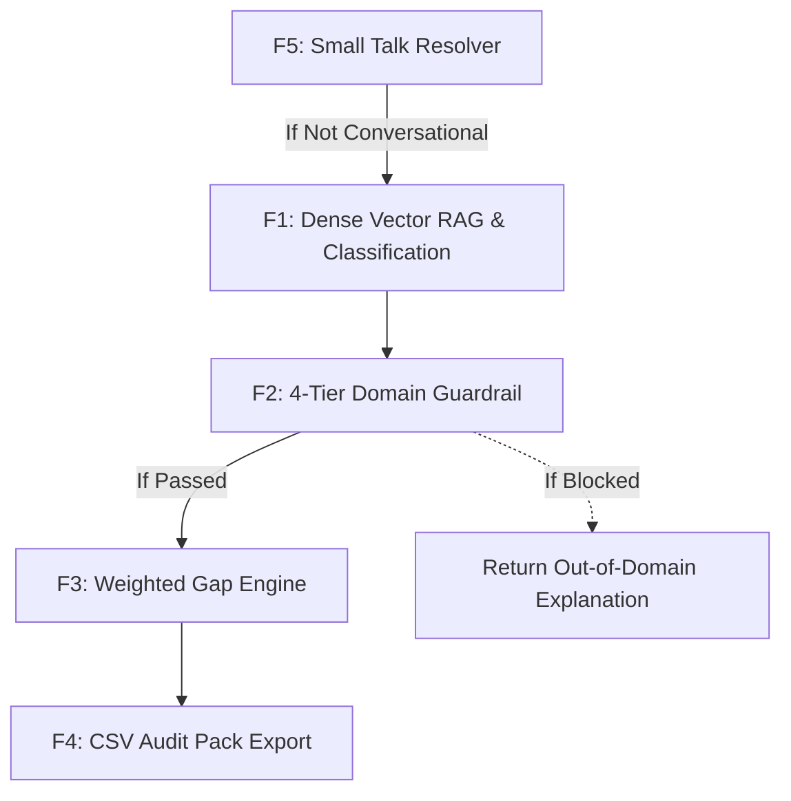

# Step 2: Feature Inventory & Detailed Technical Specifications

## Master Feature Catalog

| ID | Feature Name | Core File & Location | Primary Purpose | User-Facing Impact |
| :--- | :--- | :--- | :--- | :--- |
| **F1** | [Standard Identification via Dense Vector RAG](file:///Users/avishjain/avishjain9-repos/21-bis-compliance-engine/docs/features/F1-standard-identification-rag.md) | [`app.py:L73-L93`](file:///Users/avishjain/avishjain9-repos/21-bis-compliance-engine/app.py#L73-L93) | FastEmbed ONNX (bge-small) + FAISS (IndexFlatIP) top-1 nearest neighbor retrieval | Resolves matching IS/AIS standard code and gazette citations in <20ms |
| **F2** | [Regulatory Guardrailing & Out-of-Domain Filter](file:///Users/avishjain/avishjain9-repos/21-bis-compliance-engine/docs/features/F2-regulatory-guardrail.md) | [`guardrail.py:L1-L42`](file:///Users/avishjain/avishjain9-repos/21-bis-compliance-engine/guardrail.py#L1-L42) | 4-tier filtering (blacklist, regex, statutory roots, 0.45 cosine threshold) | Blocks commercial/non-statutory noise (crypto, food, cutlery) |
| **F3** | [Factory Readiness & Gap Analysis Engine](file:///Users/avishjain/avishjain9-repos/21-bis-compliance-engine/docs/features/F3-factory-readiness-gap-engine.md) | [`gap_engine.py:L4-L59`](file:///Users/avishjain/avishjain9-repos/21-bis-compliance-engine/gap_engine.py#L4-L59) | Dynamic weighted gap scoring for BIS Scheme-I and AIS Homologation | Computes exact readiness %, flags critical deficits, provides remedial actions |
| **F4** | [Statutory Audit Pack CSV Export](file:///Users/avishjain/avishjain9-repos/21-bis-compliance-engine/docs/features/F4-statutory-audit-pack-export.md) | [`app.py:L140-L152`](file:///Users/avishjain/avishjain9-repos/21-bis-compliance-engine/app.py#L140-L152) | RFC 4180 CSV export via Python's `io.StringIO` and `csv.writer` | One-click download of audit findings into ERP/Excel spreadsheets |
| **F5** | [Conversational Officer & Intent Resolver](file:///Users/avishjain/avishjain9-repos/21-bis-compliance-engine/docs/features/F5-conversational-compliance-officer.md) | [`app.py:L31-L59`](file:///Users/avishjain/avishjain9-repos/21-bis-compliance-engine/app.py#L31-L59) | Sub-microsecond regex/prefix intent resolution for small talk | Natural onboarding guidance without triggering unnecessary vector search |

---

## Complete Feature Matrix & Dependencies

### Feature Dependencies Table
| Feature | Prerequisites (Must Exist First) | Data Consumed | Output Emitted |
| :--- | :--- | :--- | :--- |
| **F1 (RAG Search)** | Pre-computed `model2_rag_faiss.index`, `model2_corpus.json`, `FastEmbed` | User product query string | Matched standard record & cosine similarity score |
| **F2 (Guardrail)** | F1 candidate match & similarity score | Query, matched standard code, score | Boolean pass flag & statutory explanation |
| **F3 (Gap Engine)** | F1 matched standard, F2 validation, user checked documents | Document IDs list, standard string | Score percentage, status, critical flags, remediation list |
| **F4 (CSV Export)** | F1 standard metadata, F3 readiness evaluation | Query text, document checklist | Formatted RFC-4180 CSV file stream |
| **F5 (Small Talk)** | Pre-cached trigger list | User message string | Narrative onboarding reply |

---

## Say It Out Loud Scripts (Feature by Feature)

### F1: Semantic Standard Identification
> "I built the Semantic Standard Identification feature so that manufacturers and compliance officers don't have to manually comb through hundreds of Indian Standard gazettes to figure out which statutory rules apply to their product. When a user enters a product description like 'Ordinary Portland Cement 53 Grade' into the chat box in App.jsx, the frontend sends an HTTP POST request to the /chat endpoint in app.py. The backend takes that text and passes it to an air-gapped FastEmbed model running BAAI/bge-small-en-v1.5 on CPU via ONNX Runtime. This converts the text into a 384-dimensional dense vector in about fourteen milliseconds without making any external cloud API calls. Next, that vector is passed to a FAISS IndexFlatIP vector index, which computes the inner product cosine similarity against our pre-indexed master corpus in model2_corpus.json in less than a millisecond. In parallel, our serialized Scikit-Learn model bis_product_department_model_v3.pkl predicts the governing department, such as Civil Engineering or Automotive Homologation. I chose this local ONNX and FAISS architecture over a third-party LLM API like OpenAI because industrial clients require complete confidentiality for unreleased products, and local embeddings guarantee zero token costs and sub-twenty-millisecond response times. If the user submits an empty string, the API throws an HTTP 400 validation error, and if the query doesn't match any statutory regulatory scope, our downstream guardrail catches it. One honest limitation right now is that the retrieval is set to k equals one, which only returns the single top standard; in the next version, I plan to expose the top-three candidate standards with confidence bars so users can evaluate composite products."

### F2: Regulatory Guardrailing & Out-of-Domain Filter
> "I built the Regulatory Guardrail feature to solve a classic problem with vector search: cosine similarity will always return a nearest neighbor even if the user asks something completely ridiculous like 'what is the price of bitcoin' or 'give me a recipe for pizza.' Without a guardrail, the system would hallucinate an official Indian Standard for unregulated goods. In app.py, right after FAISS returns the top-matching standard and its similarity score, the query is passed into check_domain_guardrail in guardrail.py. I designed this as a four-tier filtering pipeline. In tier one, it scans against a blacklist of non-statutory commercial terms like cryptocurrency, entertainment, or dining cutlery. In tier two, if the user explicitly typed a three-to-five digit standard number like 12269 or 156, it uses a regular expression to give an instant pass. In tier three, it looks for core statutory keywords like cement, rebar, or battery; if one is present and the vector similarity is at least 0.20, it passes. Finally, in tier four, any generalized product description must clear a dense semantic similarity threshold of 0.45. I chose this hybrid approach of rule-based regex combined with vector scoring over an LLM-based safety checker because it executes in less than a tenth of a millisecond and requires zero tokens or GPU memory. When a query fails, the backend returns a polite explanation stating that the product does not fall under statutory BIS or AIS mandates and suppresses the audit pack. One trade-off is that very novel or emerging products that don't share our defined roots might require tuning the 0.45 similarity threshold."

### F3: Factory Readiness & Gap Analysis Engine
> "I built the Factory Readiness Gap Engine so that factories don't just find out which standard applies, but know exactly whether they can pass a surprise government audit tomorrow morning. In gap_engine.py, the evaluate_readiness function dynamically detects whether the identified standard belongs to Bureau of Indian Standards Scheme-I or Automotive Industry Standards Homologation. If the standard contains the letters 'AIS', it activates our automotive checklist; otherwise, it defaults to the BIS Scheme-I checklist. It then matches the factory's verified artifacts against weighted criteria totaling one hundred percent. For example, under BIS Scheme-I, having clause-specific in-house test benches carries twenty-five percent weight, while valid NABL calibration certificates carry fifteen percent. If any mandatory item marked critical is missing, the engine automatically flags a critical deficit and drops the status to Non-Compliant, even if the factory has a passing numerical score. I selected a transparent, deterministic rule-based scoring engine instead of an LLM because compliance calculations must be completely mathematically reproducible and auditable in legal proceedings. When evaluated, the engine returns an exact percentage, a list of specific missing items, and the exact remediation action, which renders live on the React frontend. One limitation is that currently documents are verified via checkbox selection; in future releases, we plan to parse uploaded PDF certificates using optical character recognition to verify NABL accreditation numbers automatically."

### F4: Statutory Audit Pack CSV Export
> "I built the Statutory Audit Pack Export feature so that quality managers can immediately download an official compliance record and share it with plant managers or regulatory inspectors without doing manual data entry. When the user clicks the Export CSV button on an audit card in App.jsx, the frontend issues a POST request to /audit/export in app.py, carrying the query text and the list of checked factory documents. The backend retrieves the matched standard from FAISS, computes the gap evaluation, and calls generate_csv_report in gap_engine.py. This function utilizes Python's native csv writer and StringIO to structure the report with the official standard title, Quality Control Order notification, assigned NABL laboratory, computed readiness score, and an itemized breakdown of every missing document along with its specific remedial action. The backend streams this as a plain text response with a text/csv MIME type and a Content-Disposition attachment header. The frontend turns the stream into a dynamic browser Blob URL and triggers an automatic download. I chose CSV over PDF for the initial release because compliance officers and operations managers need to import audit findings directly into enterprise Excel trackers and ERP systems. One limitation is that it currently only outputs CSV; adding a styled PDF export with official QR code verification is our next planned milestone."

### F5: Conversational Compliance Officer
> "I built the Conversational Compliance Officer feature because in real-world usage, users don't always start by typing a rigid product code; they often begin with 'hello', 'who are you', or 'how do I use this.' In app.py, before executing the Scikit-Learn classifier or generating dense ONNX embeddings, the chat endpoint passes the raw message to is_conversational. This helper checks if the query matches our list of conversational triggers like 'namaste', 'help', or 'thanks'. If a match is found, resolve_small_talk routes the prompt to a pre-defined regulatory guidance message. For instance, if the user asks 'who are you', it immediately clarifies that it is an air-gapped compliance officer built to audit products against Indian Standards and Automotive AIS regulations, and gives them examples of valid queries like 'Portland Pozzolana Cement.' I chose this rule-based short-circuit rather than letting an embedding model process small talk because it executes in less than a microsecond, eliminates unnecessary vector computation, and prevents the system from accidentally matching 'hello' to a random steel or chemical standard. When it responds, it sets the audit data field to null so the frontend displays a clean narrative bubble without rendering an empty audit card."
