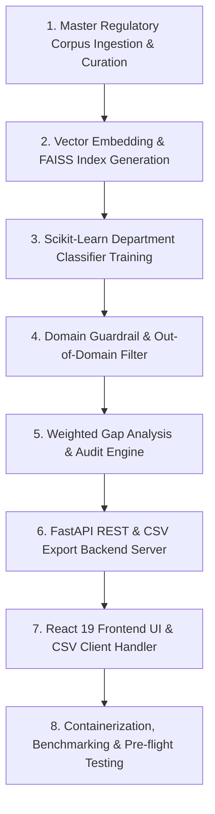

# Step 3: Build Order & Step-by-Step Rebuild Guide

This guide details how to reconstruct the **21-BIS-Compliance-Engine** from scratch in chronological order. Each phase builds upon the previous, explaining why that step is taken, which files are created, and provides the core implementation snippets.



---

## Phase 1: Master Regulatory Corpus Ingestion & Curation

### Why This Step First?
A RAG retrieval engine cannot function without grounded, high-fidelity knowledge. Before writing server routes or vector logic, we must assemble the authoritative catalog of Indian Standards (IS), Automotive Industry Standards (AIS), Quality Control Orders (QCOs), and testing laboratories.

### Files Created
- [`model2_corpus.json`](file:///Users/avishjain/avishjain9-repos/21-bis-compliance-engine/model2_corpus.json)
- [`bulk_ingest.py`](file:///Users/avishjain/avishjain9-repos/21-bis-compliance-engine/bulk_ingest.py)
- [`merge_corpus.py`](file:///Users/avishjain/avishjain9-repos/21-bis-compliance-engine/merge_corpus.py)

### Key Implementation Snippet
```python
# bulk_ingest.py (excerpt)
entry = {
    "is_number": item["is_number"],
    "product_name": item["product_name"],
    "text": f"{item['is_number']}: {item['product_name']} - {item['scope']} Mandated under {item['qco']} ({item['department']}).",
    "department": item["department"],
    "source_url": f"https://standards.bis.gov.in/search_standard/{item['is_number'].replace(' ', '-').lower()}"
}
existing_corpus.append(entry)
```
- **Line 1**: Formats the entry object with canonical standard designation and descriptive metadata.
- **Line 4**: Constructs the semantic search text block concatenating standard designation, product keywords, scope, and governing order.
- **Line 6**: Synthesizes the direct regulatory portal reference citation.

---

## Phase 2: Vector Embedding & FAISS Index Generation

### Why This Step?
To achieve sub-millisecond retrieval without paying cloud LLM token fees or relying on heavyweight PyTorch libraries, we use FastEmbed ONNX (`bge-small-en-v1.5`) to encode our corpus and store the vectors in a FAISS inner-product index.

### Files Created
- [`rebuild_faiss_index.py`](file:///Users/avishjain/avishjain9-repos/21-bis-compliance-engine/rebuild_faiss_index.py)
- [`model2_rag_faiss.index`](file:///Users/avishjain/avishjain9-repos/21-bis-compliance-engine/model2_rag_faiss.index)

### Key Implementation Snippet
```python
# rebuild_faiss_index.py (Lines 15-23)
embeddings = np.array(list(embedder.embed(docs)), dtype="float32")
faiss.normalize_L2(embeddings)

dim = embeddings.shape[1]
index = faiss.IndexFlatIP(dim)
index.add(embeddings)

faiss.write_index(index, "model2_rag_faiss.index")
```
- **Line 1**: Generates 384-dimensional dense vectors using FastEmbed's ONNX runtime.
- **Line 2**: Normalizes vector lengths to unit norm ($L_2 = 1.0$), ensuring inner product queries equal cosine similarity.
- **Line 4-5**: Instantiates an exact inner-product FAISS index (`IndexFlatIP`) matching dimension (384).
- **Line 6-8**: Indexes document embeddings and serializes to disk.

---

## Phase 3: Scikit-Learn Department Classifier

### Why This Step?
Industrial products in India are regulated by distinct ministries (Ministry of Steel, DPIIT, MeitY, MoRTH). While dense vector search locates the exact standard, a supervised classifier provides immediate administrative routing and department categorization.

### Files Created
- [`bis_product_department_model_v3.pkl`](file:///Users/avishjain/avishjain9-repos/21-bis-compliance-engine/bis_product_department_model_v3.pkl)

---

## Phase 4: Domain Guardrail & Out-of-Domain Filter

### Why This Step?
Dense vector similarity always produces a numerical nearest neighbor. Without a guardrail, out-of-domain queries like "crypto" or "cutlery" would falsely return industrial standards.

### Files Created
- [`guardrail.py`](file:///Users/avishjain/avishjain9-repos/21-bis-compliance-engine/guardrail.py)
- [`eval_guardrail.py`](file:///Users/avishjain/avishjain9-repos/21-bis-compliance-engine/eval_guardrail.py)

### Key Implementation Snippet
```python
# guardrail.py (Lines 22-25, 38-41)
query_digits = re.findall(r'\b\d{3,5}\b', q)
matched_digits = re.findall(r'\b\d{3,5}\b', matched_standard.lower())
if any(d in matched_digits for d in query_digits):
    return True, "Passed via exact statutory standard code match."

if similarity_score >= 0.45:
    return True, "Strong semantic standard alignment."
return False, f"Relevance score ({round(similarity_score, 3)}) is below required threshold."
```
- **Line 1-4**: Uses regex tokenization to pass any query containing the exact digits of the target standard.
- **Line 6-8**: Enforces a strict 0.45 cosine similarity floor for general product descriptions.

---

## Phase 5: Weighted Gap Analysis & Audit Pack Engine

### Why This Step?
Manufacturers need actionable compliance determinations: readiness percentage, critical non-compliances, and required actions.

### Files Created
- [`gap_engine.py`](file:///Users/avishjain/avishjain9-repos/21-bis-compliance-engine/gap_engine.py)

### Key Implementation Snippet
```python
# gap_engine.py (Lines 30-49)
for key, item in active_checklist.items():
    if key in uploaded_docs:
        score += item["weight"]
        fulfilled.append(item["name"])
    else:
        if item["critical"]:
            has_critical_gap = True
        gaps.append({"item": item["name"], "action_required": item["action"]})

if score >= 85 and not has_critical_gap:
    status = "Audit Ready (Minimal Compliance Risk)"
elif score >= 60:
    status = "Conditional Readiness (Minor Gaps Present)"
else:
    status = "Non-Compliant (Critical Deficits Identified)"
```
- **Line 1-7**: Iterates active regulatory checklist, computing cumulative score and tagging missing critical items.
- **Line 9-15**: Maps score and criticality status to official legal audit determinations.

---

## Phase 6: FastAPI REST & CSV Export Backend Server

### Why This Step?
Exposes the RAG retrieval, guardrailing, gap analysis, and CSV streaming capabilities over clean HTTP JSON and MIME endpoints.

### Files Created
- [`app.py`](file:///Users/avishjain/avishjain9-repos/21-bis-compliance-engine/app.py)
- [`requirements.txt`](file:///Users/avishjain/avishjain9-repos/21-bis-compliance-engine/requirements.txt)

---

## Phase 7: React 19 Frontend UI & CSV Client Handler

### Why This Step?
Provides compliance officers with a sleek, dark-mode single page interface featuring document checkboxes, chat history, interactive audit cards, and one-click CSV export.

### Files Created
- [`bis-frontend/src/App.jsx`](file:///Users/avishjain/avishjain9-repos/21-bis-compliance-engine/bis-frontend/src/App.jsx)
- [`bis-frontend/package.json`](file:///Users/avishjain/avishjain9-repos/21-bis-compliance-engine/bis-frontend/package.json)

---

## Phase 8: Containerization & Pre-flight Testing

### Why This Step?
Packaging into an air-gapped container ensures seamless deployment on any local factory server or cloud host.

### Files Created
- [`Dockerfile`](file:///Users/avishjain/avishjain9-repos/21-bis-compliance-engine/Dockerfile)
- [`smoke_check.py`](file:///Users/avishjain/avishjain9-repos/21-bis-compliance-engine/smoke_check.py)
