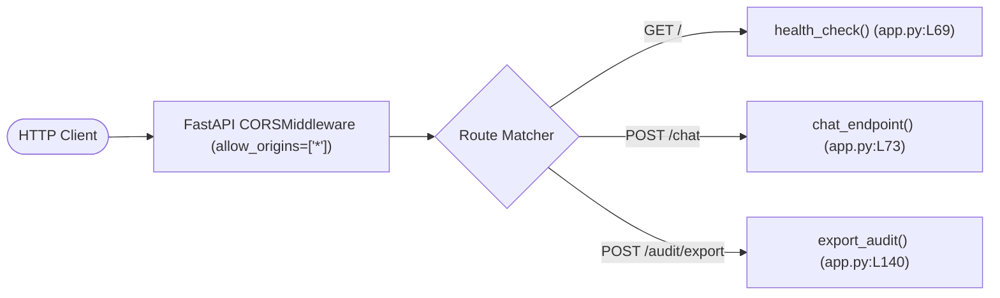

# Step 4: Complete API Reference

The backend exposes three HTTP endpoints on port `8000` (or the configured `PORT` in Docker). All requests pass through the FastAPI ASGI middleware pipeline before hitting the controller handlers.



---

## 1. GET `/` - Service Health Check

### Overview
Validates server operational status, verifying that the ASGI server is live and capable of accepting socket connections.

- **Method**: `GET`
- **Path**: `/`
- **Authentication**: None required (`Public`)
- **Headers**: None
- **Query / Path Parameters**: None
- **Request Body**: None
- **Middleware Chain**: `CORSMiddleware`
- **Rate Limits**: Unrestricted

### Success Response (`200 OK`)
```json
{
  "status": "live",
  "service": "BIS & AIS Compliance Engine"
}
```

### Error Responses
- **`500 Internal Server Error`**: Emitted if Uvicorn fails to dispatch worker threads or process memory is corrupted.

### cURL Example
```bash
curl -X GET http://127.0.0.1:8000/
```

---

## 2. POST `/chat` - Primary Compliance & Audit Endpoint

### Overview
The primary regulatory interface. Accepts arbitrary user queries, checks conversational intent, resolves standard classification via Scikit-Learn, executes dense vector RAG over FAISS, verifies domain guardrails, and evaluates statutory factory readiness.

- **Method**: `POST`
- **Path**: `/chat`
- **Authentication**: None required (`Public`)
- **Headers**: `Content-Type: application/json`
- **Validation Rules**:
  - `message`: Required non-empty string. Whitespace-only strings trigger `400 Bad Request`.
  - `documents`: Optional list of strings. Defaults to `["factory_layout", "qc_personnel"]`.
- **Controller Function**: `chat_endpoint()` in [`app.py:L73-L138`](file:///Users/avishjain/avishjain9-repos/21-bis-compliance-engine/app.py#L73-L138)
- **Middleware Chain**: `CORSMiddleware` $\rightarrow$ `Pydantic V2 Request Deserializer`

### Request Body Schema (`QueryRequest`)
```json
{
  "message": "Ordinary Portland Cement 53 Grade",
  "documents": [
    "factory_layout",
    "test_equipment",
    "calibration_certs",
    "qc_personnel"
  ]
}
```

### Success Response 1: Statutory Match (`200 OK`)
```json
{
  "reply": "Verified standard: IS 12269:2013. Governing Order: Cement (Quality Control) Order 2003. Calculated readiness score: 70% (Conditional Readiness (Minor Gaps Present)).",
  "audit_data": {
    "classification": {
      "predicted_department": "CED",
      "similarity_score": 0.8421
    },
    "audit_pack": {
      "governance": {
        "standard": "IS 12269:2013",
        "qco_order": "Cement (Quality Control) Order 2003",
        "scheme": "Scheme-I (ISI Mark)",
        "filing_portal": "Manakonline Portal",
        "citation": {
          "clause_reference": "IS 12269:2013, Clause 6 (Physical Requirements) & Clause 10 (Marking)",
          "source_url": "https://www.manakonline.in",
          "statutory_act": "BIS Act 2016, Section 16 (Mandatory QCO S.O. 235(E))"
        }
      },
      "testing_and_labs": {
        "authorized_lab": "National Council for Cement and Building Materials (NCCBM)",
        "surveillance_audit": "Mandatory In-House Physical Strength & Soundness Surveillance"
      },
      "gap_and_readiness": {
        "regime": "BIS Scheme-I (ISI Mark)",
        "readiness_score": "70%",
        "status": "Conditional Readiness (Minor Gaps Present)",
        "critical_gap_flag": false,
        "fulfilled_criteria": [
          "Factory Layout & Production Machinery List",
          "Mandatory In-House Test Benches (Clause-Specific)",
          "Valid NABL Calibration Certificates (<1 yr)",
          "Qualified Quality Control Personnel Undertaking"
        ],
        "gaps_identified": [
          {
            "item": "Raw Material Test Certificates & Traceability Log",
            "weight_loss": 15,
            "critical": false,
            "action_required": "Maintain supplier batch test certificates and raw material acceptance logs."
          },
          {
            "item": "Scheme of Inspection and Testing (SIT) Register",
            "weight_loss": 15,
            "critical": false,
            "action_required": "Implement daily production batch testing register matching the official BIS SIT format."
          }
        ],
        "actionable_next_step": "Maintain supplier batch test certificates and raw material acceptance logs."
      }
    }
  }
}
```

### Success Response 2: Guardrail Rejection (`200 OK`)
```json
{
  "reply": "The query 'bitcoin crypto exchange' does not fall under statutory BIS or AIS mandatory standards. Query falls under non-statutory commercial or unregulated consumer category.",
  "audit_data": null
}
```

### Success Response 3: Conversational Greeting (`200 OK`)
```json
{
  "reply": "Namaste! I am your regulatory compliance assistant. You can ask me to evaluate industrial products under BIS Scheme-I or automotive safety components under AIS Homologation.",
  "audit_data": null
}
```

### Error Responses
- **`400 Bad Request`**:
  ```json
  {
    "detail": "Empty query."
  }
  ```
- **`422 Unprocessable Entity`**: Emitted by Pydantic when JSON body does not match expected schema (e.g., passing integer instead of string in `message`).

### cURL Example
```bash
curl -X POST http://127.0.0.1:8000/chat \
  -H "Content-Type: application/json" \
  -d '{"message": "IS 12269", "documents": ["factory_layout", "qc_personnel"]}'
```

---

## 3. POST `/audit/export` - Statutory Audit CSV Stream

### Overview
Takes a verified product query and document list, computes the gap determination, and streams an RFC 4180-compliant CSV report with browser download attachment headers.

- **Method**: `POST`
- **Path**: `/audit/export`
- **Authentication**: None required (`Public`)
- **Headers**: `Content-Type: application/json`
- **Controller Function**: `export_audit()` in [`app.py:L140-L152`](file:///Users/avishjain/avishjain9-repos/21-bis-compliance-engine/app.py#L140-L152)
- **Response Type**: `text/csv` stream with `Content-Disposition: attachment; filename=Audit_<Query>.csv`

### Request Body Schema (`AuditExportRequest`)
```json
{
  "text": "Ordinary Portland Cement 53 Grade",
  "documents": ["factory_layout", "test_equipment"]
}
```

### Success Response (`200 OK`, `text/csv`)
```csv
REGULATORY AUDIT REPORT - STATUTORY COMPLIANCE DETERMINATION
Query Input,Ordinary Portland Cement 53 Grade
Standard,IS 12269:2013
Regulatory Regime,BIS Scheme-I (ISI Mark)
Quality Control Order,Cement (Quality Control) Order 2003
Authorized Lab,National Council for Cement and Building Materials (NCCBM)
Readiness Score,40%
Audit Status,Non-Compliant (Critical Deficits Identified)

DEFICIENT STATUTORY ARTIFACTS,IMPACT (WEIGHT),CRITICAL,REQUIRED ACTION
Valid NABL Calibration Certificates (<1 yr),-15%,YES,Ensure all testing instruments have unexpired calibration from NABL-accredited labs.
Qualified Quality Control Personnel Undertaking,-15%,YES,Appoint designated QC chemist/engineer with qualification certificates filed.
Raw Material Test Certificates & Traceability Log,-15%,NO,Maintain supplier batch test certificates and raw material acceptance logs.
Scheme of Inspection and Testing (SIT) Register,-15%,NO,Implement daily production batch testing register matching the official BIS SIT format.
```

### cURL Example
```bash
curl -X POST http://127.0.0.1:8000/audit/export \
  -H "Content-Type: application/json" \
  -d '{"text": "TMT Rebars IS 1786", "documents": ["factory_layout"]}' \
  --output Audit_IS_1786.csv
```
