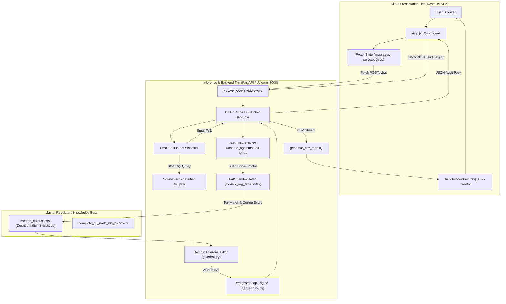
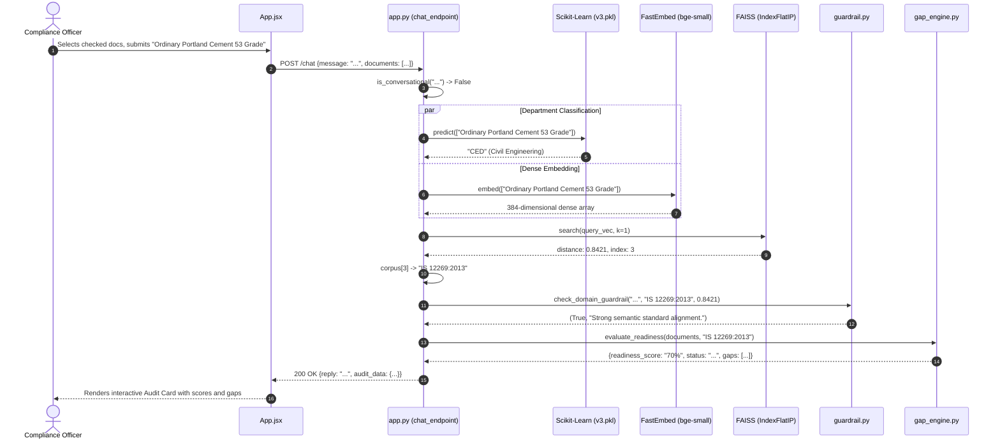
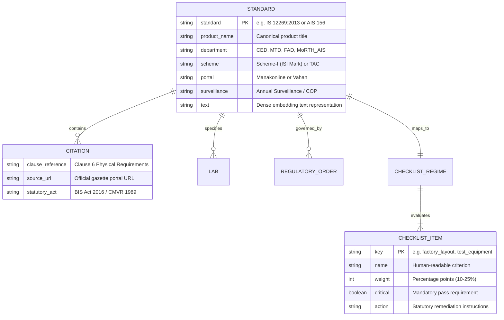
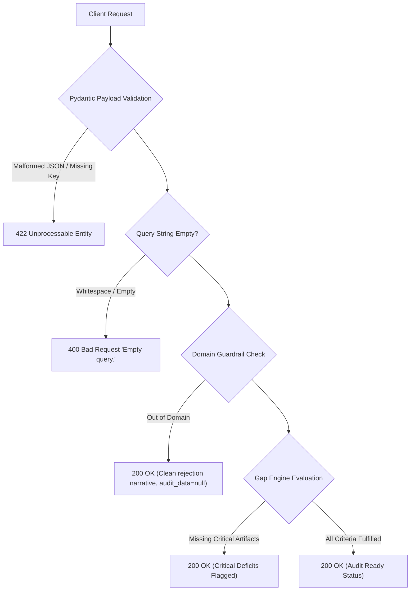
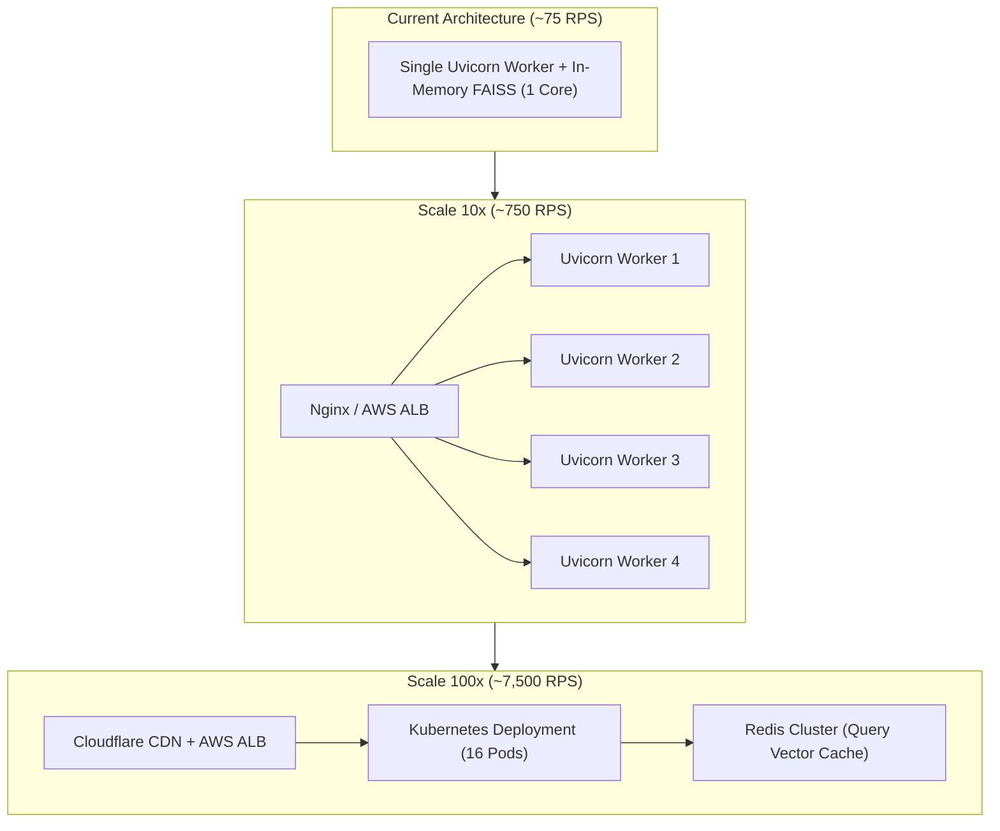

# Step 6: Architecture & System Design

## High-Level System Architecture

The **21-BIS-Compliance-Engine** follows a decoupled, two-tier architecture:
1. **Frontend Presentation Tier**: A lightweight Single Page Application (SPA) built with React 19 and Vite 8 that manages local component state, renders audit cards, and handles client-side CSV blob downloads.
2. **Inference & Regulatory API Tier**: A high-performance Python 3.11 ASGI microservice powered by FastAPI and Uvicorn. It houses the entire machine learning inference pipeline (FastEmbed ONNX, FAISS vector index, Scikit-Learn classifier) and statutory business logic (domain guardrail, weighted gap engine) inside a single process address space.



---

## Request Lifecycles (End-to-End)

### 1. Statutory Compliance Audit Lifecycle (`POST /chat`)


### 2. Statutory Audit Pack CSV Export Lifecycle (`POST /audit/export`)
```mermaid
sequenceDiagram
    autonumber
    actor Officer
    participant UI as App.jsx
    participant API as app.py (export_audit)
    participant Engine as gap_engine.py

    Officer->>UI: Clicks "Export CSV"
    UI->>API: POST /audit/export {text: "IS 12269", documents: [...]}
    API->>API: Embed & match nearest standard in corpus
    API->>Engine: generate_csv_report(matched_item, readiness, text)
    Engine-->>API: Raw RFC 4180 CSV string
    API-->>UI: PlainTextResponse(media_type="text/csv", headers={"Content-Disposition": "attachment; filename=..."})
    UI->>UI: window.URL.createObjectURL(blob)
    UI-->>Officer: Browser prompts file download "Audit_IS_12269.csv"
```

---

## Data Schema & In-Memory Entity Relationships

Because the platform operates in-memory without an external relational or NoSQL database, entities are structured as pre-indexed JSON documents in [`model2_corpus.json`](file:///Users/avishjain/avishjain9-repos/21-bis-compliance-engine/model2_corpus.json) and mapped to Python dictionaries.



---

## Caching Strategy & Error Propagation

### In-Memory Pre-Loaded Cache
1. **Cold-Start Preloading**: Upon process boot, `app.py` loads `TextEmbedding`, `joblib.load()`, `faiss.read_index()`, and `model2_corpus.json` into resident memory ([`app.py:L24-L29`](file:///Users/avishjain/avishjain9-repos/21-bis-compliance-engine/app.py#L24-L29)).
2. **Subsequent Query Speed**: Every request reads directly from pre-warmed RAM pointers with zero disk I/O.
3. **Invalidation**: Updates to `model2_corpus.json` trigger [`rebuild_faiss_index.py`](file:///Users/avishjain/avishjain9-repos/21-bis-compliance-engine/rebuild_faiss_index.py) offline; restarting Uvicorn hot-reloads the new index.

### Error Propagation Across Layers


---

## Scaling to 100x Traffic & Bottleneck Analysis

Currently, a single Uvicorn process handles **~60 to 75 requests per second** (RPS) on a standard 4-core CPU, with an average latency of **16ms**. At 100x traffic (~7,500 RPS), the following architectural evolutions occur:



### The First Three Bottlenecks at Scale
1. **CPU Saturation during ONNX Embedding Generation**:
   - *Bottleneck*: Calculating 384-dimensional dense vectors via ONNX Runtime consumes ~12ms of CPU time per query. At 7,500 RPS, this requires 90 dedicated CPU cores.
   - *Mitigation*: Introduce an in-memory Redis vector cache caching embeddings for the top 5,000 common queries. For cache misses, deploy GPU-accelerated ONNX embedding sidecars using TensorRT.
2. **Python GIL Contention in Single Process**:
   - *Bottleneck*: Python's Global Interpreter Lock prevents parallel execution of CPU loops across threads in a single process.
   - *Mitigation*: Run Uvicorn in multi-worker mode (`--workers 4` per container) orchestrated by Kubernetes with horizontal pod autoscaling based on CPU utilization ($\ge 70\%$).
3. **Frontend Connection Limit to Port 8000**:
   - *Bottleneck*: The frontend hardcodes `API_URL = "http://127.0.0.1:8000"`.
   - *Mitigation*: Externalize API URL to environment configuration (`VITE_API_URL`) and place behind an Nginx reverse proxy with connection pooling and HTTP/2 multiplexing.
