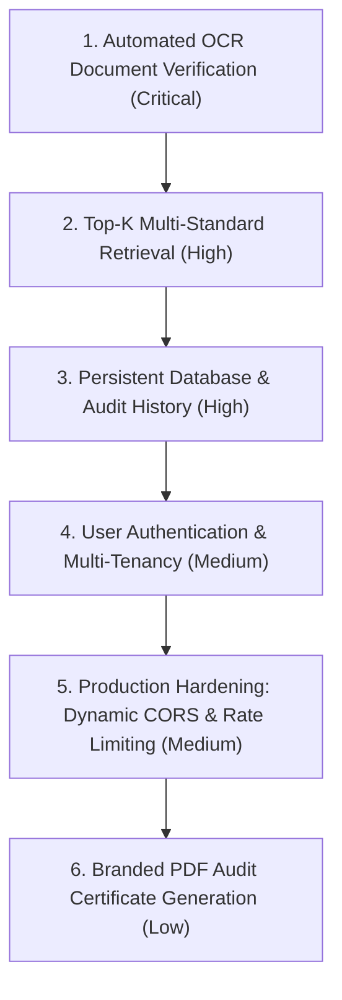

# Step 11: Architectural Gaps & Production Roadmap

This document outlines the known architectural gaps and technical debt in the current **21-BIS-Compliance-Engine** implementation, ranked by business and engineering criticality, along with concrete remediation proposals.

---

## Prioritized Gaps & Fix Suggestions

### 1. Automated Document Verification via OCR (Critical)
- **Current State**: Users manually check compliance artifacts via checkboxes in the UI ([`App.jsx:L119-L134`](file:///Users/avishjain/avishjain9-repos/21-bis-compliance-engine/bis-frontend/src/App.jsx#L119-L134)).
- **Risk**: An auditor or user can check all boxes without providing authentic legal proof, resulting in unverified "Audit Ready" determinations.
- **Fix Suggestion**: Add a multipart file upload route `POST /audit/verify-document` that uses Tesseract OCR or Google Document AI to parse PDF calibration certificates, extract NABL accreditation numbers, check expiration dates against the current date, and verify validity automatically.

### 2. Multi-Candidate Standard Retrieval ($k > 1$) (High)
- **Current State**: Search query hardcodes `index.search(query_vec, k=1)` in [`app.py:L90`](file:///Users/avishjain/avishjain9-repos/21-bis-compliance-engine/app.py#L90), returning only the single nearest standard.
- **Risk**: Complex industrial products (e.g., an electric vehicle that requires both AIS 156 for its battery and AIS 004 for electromagnetic compatibility) cannot be audited comprehensively in a single session.
- **Fix Suggestion**: Upgrade retrieval to $k=3$, calculate relative confidence percentages, and allow the user to select the primary standard or run a joint composite audit pack.

### 3. Persistent Database & Audit History (High)
- **Current State**: All state is ephemeral in client memory. Refreshing the browser resets the chat stream and audit packs.
- **Risk**: Quality directors cannot review historic factory audits or track readiness score progression over time.
- **Fix Suggestion**: Integrate SQLite (for single-node edge deployments) or PostgreSQL with SQLAlchemy/Alembic migrations, storing audit records, user IDs, timestamped findings, and exported report links.

### 4. Authentication, Authorization & Multi-Tenancy (Medium)
- **Current State**: Endpoints are public and unauthenticated.
- **Risk**: Competitors or unauthorized users on local networks can execute unlimited queries.
- **Fix Suggestion**: Implement OAuth 2.0 with JWT access and refresh tokens, supporting role-based access control (RBAC) with roles: `Auditor`, `FactoryManager`, and `Guest`.

### 5. Production Hardening: Dynamic CORS & Rate Limiting (Medium)
- **Current State**: CORS allows all origins (`*`) in [`app.py:L18`](file:///Users/avishjain/avishjain9-repos/21-bis-compliance-engine/app.py#L18); frontend hardcodes `API_URL = "http://127.0.0.1:8000"`.
- **Risk**: Potential for CSRF abuse from third-party sites and deployment friction when hosting frontend and backend on different hostnames.
- **Fix Suggestion**: Restrict CORS to explicit allowed origins from environment variables, externalize `VITE_API_URL`, and install `slowapi` to enforce rate limits of 30 req/min per IP.

### 6. Branded PDF Audit Certificate Generation (Low)
- **Current State**: Export produces raw RFC 4180 CSV files ([`app.py:L148`](file:///Users/avishjain/avishjain9-repos/21-bis-compliance-engine/app.py#L148)).
- **Enhancement**: Add a styled PDF generator using `WeasyPrint` or `ReportLab` to output formatted audit certificates with official seal watermarks, tabular scorecards, and cryptographic QR code verification.
