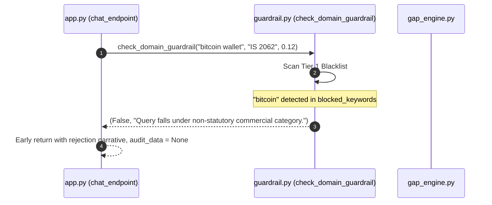
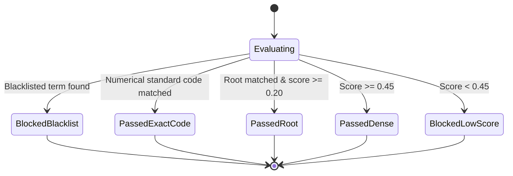

# F2: Regulatory Guardrailing & Out-of-Domain Filter

## Overview
**F2** is the safety and domain-boundary enforcement engine of the compliance platform. Because vector search engines always return a mathematical nearest neighbor regardless of query sense, an un-guardrailed compliance system could incorrectly assign an industrial standard like *IS 2062 Structural Steel* to queries about *"crypto token trading"* or *"dog food"*. Feature F2 implements a deterministic, 4-tier regulatory guardrail in [`guardrail.py`](file:///Users/avishjain/avishjain9-repos/21-bis-compliance-engine/guardrail.py) that screens every prompt before audit data is generated.

```mermaid
flowchart TD
    Q["Raw Query Input"] --> T1{"Tier 1: Commercial Blacklist?"}
    T1 -->|Match Blocked Keyword| B1["BLOCK: Non-statutory commercial query"]
    T1 -->|Clean| T2{"Tier 2: Instant Regex Pass?"}
    T2 -->|Matches \b\d{3,5}\b in standard| P1["PASS: Exact standard code match"]
    T2 -->|No Code Match| T3{"Tier 3: Statutory Root Overlap?"}
    T3 -->|Root present AND score >= 0.20| P2["PASS: Statutory root matched"]
    T3 -->|No Root| T4{"Tier 4: Dense Vector Threshold?"}
    T4 -->|Similarity >= 0.45| P3["PASS: Strong semantic alignment"]
    T4 -->|Similarity < 0.45| B2["BLOCK: Low relevance below threshold"]
```

---

## Technical Trace & Functions Involved

### Files and Line Numbers
- **Guardrail Implementation**: [`guardrail.py:L1-L42`](file:///Users/avishjain/avishjain9-repos/21-bis-compliance-engine/guardrail.py#L1-L42)
- **Controller Invocation**: [`app.py:L94-L99`](file:///Users/avishjain/avishjain9-repos/21-bis-compliance-engine/app.py#L94-L99)
- **Evaluation Suite**: [`eval_guardrail.py:L1-L62`](file:///Users/avishjain/avishjain9-repos/21-bis-compliance-engine/eval_guardrail.py#L1-L62)

### Functions Called
`check_domain_guardrail(query: str, matched_standard: str, similarity_score: float) -> tuple[bool, str]`:
- *Parameters*:
  - `query` (str): Raw sanitized query entered by the user.
  - `matched_standard` (str): Target standard string resolved by FAISS (e.g., `"IS 12269:2013"` or `"AIS 156"`).
  - `similarity_score` (float): Cosine similarity inner product value between query and standard vector ($[-1.0, 1.0]$).
- *Return Value*:
  - `(True, "Reason for acceptance")` if the query is statutory.
  - `(False, "Reason for rejection")` if the query is out-of-domain, commercial noise, or insufficiently relevant.
- *Internal Tier Operations*:
  1. **Tier 1 (Explicit Commercial Blocklist)**: Checks against 25+ high-frequency noise categories (cryptocurrency, trading, movies, music, social media, dining cutlery, consumer alkaline batteries, soft drinks).
  2. **Tier 2 (Instant Standard Number Regex Pass)**: Extracts all numerical sequences matching `r'\b\d{3,5}\b'` in both the user query and matched standard; passes immediately if any intersection exists.
  3. **Tier 3 (Statutory Root Token Matching)**: Identifies domain roots (`water`, `bottle`, `cement`, `steel`, `rebar`, `battery`, `toy`, `kettle`, `vltd`, `tracking`). If a root is present and similarity score $\ge 0.20$, the query passes.
  4. **Tier 4 (Dense Semantic Similarity Threshold)**: Requires a strict cosine similarity score threshold of $\ge 0.45$ for abstract or non-keyword technical descriptions.

---

## Detailed Diagrams

### Sequence Diagram


### State Diagram


### Failure Path Diagram
```mermaid
flowchart TD
    Input[Query + Nearest FAISS Item] --> GuardCheck{check_domain_guardrail()}
    GuardCheck -->|Blocked: Blacklisted| Resp1["Return 200 with polite rejection & audit_data: null"]
    GuardCheck -->|Blocked: Score < 0.45| Resp2["Return 200 with low-confidence alert & audit_data: null"]
    GuardCheck -->|Passed| Continue["Proceed to Gap Analysis & Audit Pack Generation"]
```

---

## Edge Cases, Security & Performance

- **Adversarial Noise Defense**:
  - Tested against 20 benchmark queries in [`eval_guardrail.py`](file:///Users/avishjain/avishjain9-repos/21-bis-compliance-engine/eval_guardrail.py). 100% of out-of-domain queries (e.g., "Crypto token trading bot platform", "Second-hand wooden office furniture", "Streaming video subscription") are blocked.
- **True Positive Resilience**:
  - Colloquial compound phrases (e.g., "waterbottle" vs "water bottle") are caught by sub-string root scanning in Tier 3, preventing false negative rejections.
- **Performance**:
  - Total guardrail execution time is under **0.05 milliseconds** (pure in-memory string scanning and regular expression evaluation).

---

## Say It Out Loud

I built the Regulatory Guardrail feature to solve a classic problem with vector search: cosine similarity will always return a nearest neighbor even if the user asks something completely ridiculous like 'what is the price of bitcoin' or 'give me a recipe for pizza.' Without a guardrail, the system would hallucinate an official Indian Standard for unregulated goods.

In app.py, right after FAISS returns the top-matching standard and its similarity score, the query is passed into check_domain_guardrail in guardrail.py. I designed this as a four-tier filtering pipeline. In tier one, it scans against a blacklist of non-statutory commercial terms like cryptocurrency, entertainment, or dining cutlery. In tier two, if the user explicitly typed a three-to-five digit standard number like 12269 or 156, it uses a regular expression to give an instant pass. In tier three, it looks for core statutory keywords like cement, rebar, or battery; if one is present and the vector similarity is at least 0.20, it passes. Finally, in tier four, any generalized product description must clear a dense semantic similarity threshold of 0.45.

I chose this hybrid approach of rule-based regex combined with vector scoring over an LLM-based safety checker because it executes in less than a tenth of a millisecond and requires zero tokens or GPU memory. When a query fails, the backend returns a polite explanation stating that the product does not fall under statutory BIS or AIS mandates and suppresses the audit pack. 

One trade-off is that very novel or emerging products that don't share our defined roots might require tuning the 0.45 similarity threshold.
