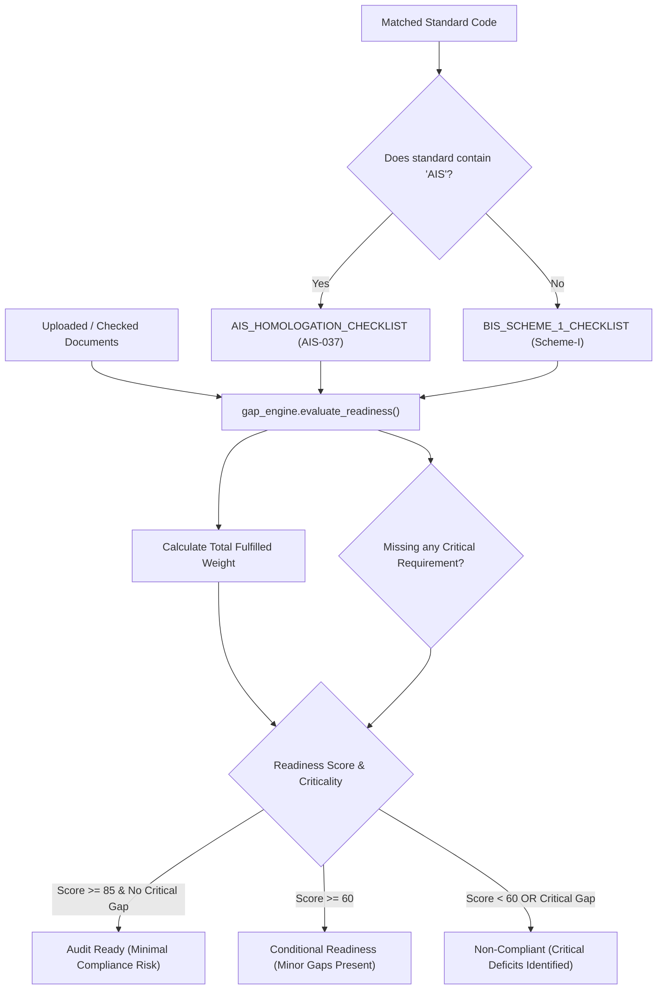
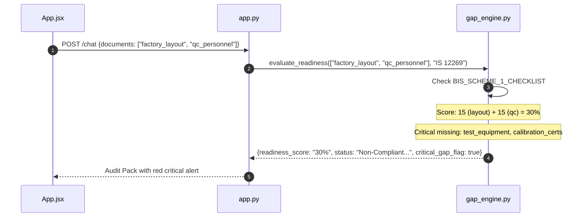

# F3: Factory Readiness & Gap Analysis Engine

## Overview
**F3** is the core quantitative assessment module of the platform. Rather than merely stating which standard applies, **F3** evaluates whether a manufacturer is legally ready to pass a statutory factory inspection. It parses verified compliance artifacts against two distinct statutory regulatory regimes:
1. **BIS Scheme-I (ISI Mark Certification)** under the *Bureau of Indian Standards Act, 2016*.
2. **Automotive AIS Homologation** under *Central Motor Vehicles Rules (CMVR), Rule 126 / AIS-037*.

---

## Technical Trace & Functions Involved

### Files and Line Numbers
- **Engine Implementation**: [`gap_engine.py:L4-L59`](file:///Users/avishjain/avishjain9-repos/21-bis-compliance-engine/gap_engine.py#L4-L59)
- **Controller Invocation**: [`app.py:L101`](file:///Users/avishjain/avishjain9-repos/21-bis-compliance-engine/app.py#L101) and [`app.py:L145`](file:///Users/avishjain/avishjain9-repos/21-bis-compliance-engine/app.py#L145)
- **Frontend State Integration**: [`App.jsx:L25`](file:///Users/avishjain/avishjain9-repos/21-bis-compliance-engine/bis-frontend/src/App.jsx#L25) and [`App.jsx:L182-L196`](file:///Users/avishjain/avishjain9-repos/21-bis-compliance-engine/bis-frontend/src/App.jsx#L182-L196)

### Statutory Checklist Weights Breakdown

#### 1. BIS Scheme-I Checklist (100% Total Weight)
| Artifact Key | Criteria Name | Weight | Critical? | Mandatory Action Required on Deficit |
| :--- | :--- | :--- | :--- | :--- |
| `factory_layout` | Factory Layout & Production Machinery List | 15% | **Yes** | Submit complete factory layout drawing and installed manufacturing machinery details. |
| `test_equipment` | Mandatory In-House Test Benches (Clause-Specific) | 25% | **Yes** | Procure and commission all required testing apparatus per the product standard SIT. |
| `calibration_certs` | Valid NABL Calibration Certificates (<1 yr) | 15% | **Yes** | Ensure all testing instruments have unexpired calibration from NABL-accredited labs. |
| `qc_personnel` | Qualified Quality Control Personnel Undertaking | 15% | **Yes** | Appoint designated QC chemist/engineer with qualification certificates filed. |
| `raw_material_certs` | Raw Material Test Certificates & Traceability Log | 15% | No | Maintain supplier batch test certificates and raw material acceptance logs. |
| `sit_register` | Scheme of Inspection and Testing (SIT) Register | 15% | No | Implement daily production batch testing register matching official BIS SIT format. |

#### 2. AIS Automotive Homologation Checklist (100% Total Weight)
| Artifact Key | Criteria Name | Weight | Critical? | Mandatory Action Required on Deficit |
| :--- | :--- | :--- | :--- | :--- |
| `form_22_drawings` | CMVR Form 22 Technical Specs & Drawings | 25% | **Yes** | Prepare complete engineering blueprints and Form 22 technical spec sheets. |
| `prototype_bench` | Homologation Prototype & Test Bench Readiness | 25% | **Yes** | Assemble compliant prototype sample for destructive/safety verification at test agency. |
| `calibration_certs` | NABL Calibration Certificates for Diagnostics | 15% | **Yes** | Provide valid calibration certificates for diagnostic benches and multimeters. |
| `cop_plan` | Conformity of Production (COP) Plan (AIS-037) | 20% | **Yes** | Establish formal COP procedural document for recurring surveillance batch audits. |
| `traceability_log` | Critical Component Sourcing & Safety Traceability | 15% | No | Maintain sub-assembly traceability records for cells, BMS, or telemetry modules. |

---

## Functions Called

`evaluate_readiness(uploaded_docs: list, standard: str = "") -> dict`:
- *Parameters*:
  - `uploaded_docs` (list[str]): List of active document IDs selected in the frontend.
  - `standard` (str): Matched standard identifier.
- *Return Value*:
  - Structured dictionary containing:
    - `regime`: String identifying regulatory framework.
    - `readiness_score`: String formatted percentage (e.g., `"70%"`).
    - `status`: Qualitative audit determination.
    - `critical_gap_flag`: Boolean indicating whether any critical criteria are unfulfilled.
    - `fulfilled_criteria`: List of satisfied requirement strings.
    - `gaps_identified`: List of deficient criteria with weight loss, criticality flag, and required statutory action.
    - `actionable_next_step`: Most immediate remediation requirement.

---

## Detailed Diagrams

### Sequence Diagram

---

## Say It Out Loud

I built the Factory Readiness Gap Engine so that factories don't just find out which standard applies, but know exactly whether they can pass a surprise government audit tomorrow morning.

In gap_engine.py, the evaluate_readiness function dynamically detects whether the identified standard belongs to Bureau of Indian Standards Scheme-I or Automotive Industry Standards Homologation. If the standard contains the letters 'AIS', it activates our automotive checklist; otherwise, it defaults to the BIS Scheme-I checklist. It then matches the factory's verified artifacts against weighted criteria totaling one hundred percent. For example, under BIS Scheme-I, having clause-specific in-house test benches carries twenty-five percent weight, while valid NABL calibration certificates carry fifteen percent. If any mandatory item marked critical is missing, the engine automatically flags a critical deficit and drops the status to Non-Compliant, even if the factory has a passing numerical score.

I selected a transparent, deterministic rule-based scoring engine instead of an LLM because compliance calculations must be completely mathematically reproducible and auditable in legal proceedings. 

When evaluated, the engine returns an exact percentage, a list of specific missing items, and the exact remediation action, which renders live on the React frontend. One limitation is that currently documents are verified via checkbox selection; in future releases, we plan to parse uploaded PDF certificates using optical character recognition to verify NABL accreditation numbers automatically.
