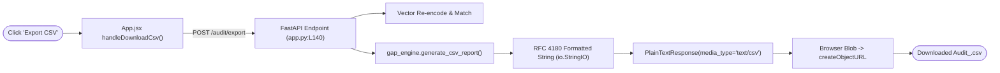

# F4: Statutory Audit Pack CSV Export

## Overview
**F4** provides compliance teams and auditors with an instant, formal statutory export capability. Rather than requiring users to manually copy findings from the browser, F4 formats the entire audit determination—including standard metadata, governing ministry, quality control orders, designated testing agencies, readiness scores, and itemized defect remediation actions—into an RFC 4180-compliant CSV report.



---

## Technical Trace & Functions Involved

### Files and Line Numbers
- **Frontend Handler**: [`App.jsx:L75-L93`](file:///Users/avishjain/avishjain9-repos/21-bis-compliance-engine/bis-frontend/src/App.jsx#L75-L93)
- **Backend Route**: [`app.py:L140-L152`](file:///Users/avishjain/avishjain9-repos/21-bis-compliance-engine/app.py#L140-L152)
- **CSV Formatter**: [`gap_engine.py:L61-L84`](file:///Users/avishjain/avishjain9-repos/21-bis-compliance-engine/gap_engine.py#L61-L84)

### Functions Called
`generate_csv_report(matched_item: dict, readiness: dict, query_text: str) -> str`:
- *Parameters*:
  - `matched_item`: Master corpus entry containing standard details and citations.
  - `readiness`: Output dictionary from `evaluate_readiness()`.
  - `query_text`: Original product query string.
- *Return Value*: UTF-8 encoded string containing full tabular report.
- *CSV Schema Structure*:
  1. Header section with Query Input, Standard, Regulatory Regime, Quality Control Order, Authorized Lab, Readiness Score, and Audit Status.
  2. Tabular Deficiencies Matrix with columns: `DEFICIENT STATUTORY ARTIFACTS`, `IMPACT (WEIGHT)`, `CRITICAL`, and `REQUIRED ACTION`.

---

## Sequence Diagram
```mermaid
sequenceDiagram
    autonumber
    actor Officer
    participant UI as App.jsx
    participant Controller as app.py (export_audit)
    participant Engine as gap_engine.py

    Officer->>UI: Clicks "Export CSV"
    UI->>Controller: POST /audit/export {text: "IS 12269", documents: [...]}
    Controller->>Engine: generate_csv_report(matched_item, readiness, "IS 12269")
    Engine-->>Controller: CSV raw text
    Controller-->>UI: PlainTextResponse(media_type="text/csv", headers={"Content-Disposition": "attachment; filename=..."})
    UI->>Officer: Browser pops download dialog for Audit_IS_12269.csv
```

---

## Say It Out Loud

I built the Statutory Audit Pack Export feature so that quality managers can immediately download an official compliance record and share it with plant managers or regulatory inspectors without doing manual data entry.

When the user clicks the Export CSV button on an audit card in App.jsx, the frontend issues a POST request to /audit/export in app.py, carrying the query text and the list of checked factory documents. The backend retrieves the matched standard from FAISS, computes the gap evaluation, and calls generate_csv_report in gap_engine.py. This function utilizes Python's native csv writer and StringIO to structure the report with the official standard title, Quality Control Order notification, assigned NABL laboratory, computed readiness score, and an itemized breakdown of every missing document along with its specific remedial action. The backend streams this as a plain text response with a text/csv MIME type and a Content-Disposition attachment header. The frontend turns the stream into a dynamic browser Blob URL and triggers an automatic download.

I chose CSV over PDF for the initial release because compliance officers and operations managers need to import audit findings directly into enterprise Excel trackers and ERP systems. 

One limitation is that it currently only outputs CSV; adding a styled PDF export with official QR code verification is our next planned milestone.
