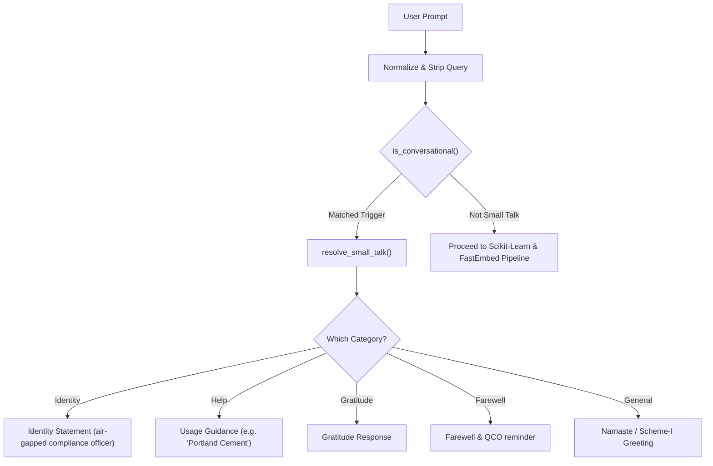

# F5: Conversational Compliance Officer & Small-Talk Intent Resolver

## Overview
**F5** provides a natural conversational onboarding experience for new users interacting with the compliance platform. Users frequently open the chat interface with standard greetings (*"Hi"*, *"Namaste"*), identity queries (*"Who are you?"*), or requests for instructions (*"Help"* or *"How does this work?"*). Rather than misinterpreting these conversational openings as industrial products and performing vector search, F5 short-circuits them in under 0.1ms and provides helpful regulatory orientation.

---

## Technical Trace & Functions Involved

### Files and Line Numbers
- **Triggers & Responses**: [`app.py:L31-L43`](file:///Users/avishjain/avishjain9-repos/21-bis-compliance-engine/app.py#L31-L43)
- **Classifier & Intent Resolver**: [`app.py:L45-L59`](file:///Users/avishjain/avishjain9-repos/21-bis-compliance-engine/app.py#L45-L59)
- **Controller Hook**: [`app.py:L79-L83`](file:///Users/avishjain/avishjain9-repos/21-bis-compliance-engine/app.py#L79-L83)

### Functions Called
1. `is_conversational(query: str) -> bool`:
   - Checks if sanitized query equals, starts with, or ends with any term in `CONVERSATIONAL_TRIGGERS` (`hi`, `hello`, `namaste`, `who are you`, `help`, `thanks`, `bye`, etc.).
2. `resolve_small_talk(query: str) -> str`:
   - Inspects query substrings and returns the appropriate pre-formatted message from `SMALL_TALK_RESPONSES`.

---

## Say It Out Loud

I built the Conversational Compliance Officer feature because in real-world usage, users don't always start by typing a rigid product code; they often begin with 'hello', 'who are you', or 'how do I use this.' 

In app.py, before executing the Scikit-Learn classifier or generating dense ONNX embeddings, the chat endpoint passes the raw message to is_conversational. This helper checks if the query matches our list of conversational triggers like 'namaste', 'help', or 'thanks'. If a match is found, resolve_small_talk routes the prompt to a pre-defined regulatory guidance message. For instance, if the user asks 'who are you', it immediately clarifies that it is an air-gapped compliance officer built to audit products against Indian Standards and Automotive AIS regulations, and gives them examples of valid queries like 'Portland Pozzolana Cement.'

I chose this rule-based short-circuit rather than letting an embedding model process small talk because it executes in less than a microsecond, eliminates unnecessary vector computation, and prevents the system from accidentally matching 'hello' to a random steel or chemical standard. 

When it responds, it sets the audit data field to null so the frontend displays a clean narrative bubble without rendering an empty audit card.
