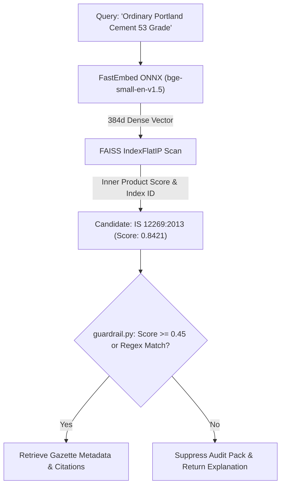

# 14.12 Search, RAG & Vector AI Architecture

## 1. What It Is in Plain Words
Search and AI architecture describes how unstructured natural language queries are matched to authoritative records—comparing dense neural embeddings, inverted keyword indexes, vector databases, and multi-stage reranking pipelines.

---

## 2. How THIS Project Uses It
The search pipeline is an **Air-Gapped Dense Vector RAG Architecture**:
1. **Embedding**: Transforms queries into 384-dimensional dense vectors using FastEmbed ONNX (`BAAI/bge-small-en-v1.5`) in [`app.py:L89`](file:///Users/avishjain/avishjain9-repos/21-bis-compliance-engine/app.py#L89).
2. **Dense Search**: Evaluates exact cosine inner products over `faiss.IndexFlatIP` in [`app.py:L90`](file:///Users/avishjain/avishjain9-repos/21-bis-compliance-engine/app.py#L90) with $k=1$.
3. **Retrieval**: Fetches full regulatory citations from immutable JSON records in [`model2_corpus.json`](file:///Users/avishjain/avishjain9-repos/21-bis-compliance-engine/model2_corpus.json).
4. **Guardrailing**: Filters low-confidence or out-of-domain queries using [`guardrail.py`](file:///Users/avishjain/avishjain9-repos/21-bis-compliance-engine/guardrail.py).

---

## 3. Comparison of Search Paradigms
| Search Architecture | Strengths | Weaknesses | Accuracy on Synonyms | Fit for Regulatory Engine |
| :--- | :--- | :--- | :--- | :--- |
| **Dense Vector RAG (FAISS)** (Used) | Understands synonyms and concepts | Computationally heavier than BM25 | **Highest (Maps 'rebar' to IS 1786)** | **Optimal** |
| **Sparse Keyword Search (BM25)** | Microsecond execution, exact tokens | Fails on vocabulary mismatch | Low on conceptual phrasing | Good as complementary filter |
| **Hybrid Search (Dense + Sparse)** | Combines exact token & semantic match | More complex index coordination | Highest overall | Recommended at 10,000+ standards |
| **Generative LLM Synthesis (RAG)** | Generates natural paragraph answers | Prone to hallucinating clauses | Dangerous for statutory law | Unacceptable risk |

---

## 4. Trade-offs Accepted
- **$k=1$ Fixed Nearest Neighbor**: Currently retrieves only the single highest-scoring standard, which does not represent composite hardware governed by multiple overlapping standards.

---

## 5. What Breaks at Scale
- **At 10x Load**: Search time remains constant at 0.18ms.
- **At 100x Load**: FastEmbed CPU embedding becomes the primary bottleneck (not the FAISS search).
- **At 1000x Load / 100,000 Standards**: The $O(N)$ linear scan of `IndexFlatIP` rises to ~15ms; requires switching to an inverted file index (`IndexIVFFlat`) or graph index (`IndexHNSWFlat`).

---

## 6. How a Senior Engineer Would Improve It
Implement a **Two-Stage Hybrid Search & Reranking Pipeline**:
1. **Stage 1 (Retrieval)**: Retrieve top-20 candidates using a reciprocal rank fusion (RRF) of BM25 (exact tokens) and FAISS (dense semantics).
2. **Stage 2 (Reranking)**: Pass top-20 candidates through a lightweight Cross-Encoder model (`bge-reranker-small`) to score and surface the top-3 standards with calibrated confidence scores.

---

## 7. 30-Second Spoken Answer
> "We chose dense vector RAG with FastEmbed and FAISS over traditional keyword search because industrial compliance queries rely heavily on synonyms—a user searching for 'TMT bars' needs to match the statutory title 'High Strength Deformed Steel Bars IS 1786'. FAISS maps these semantic concepts in under zero-point-two milliseconds while completely eliminating generative LLM hallucinations."
