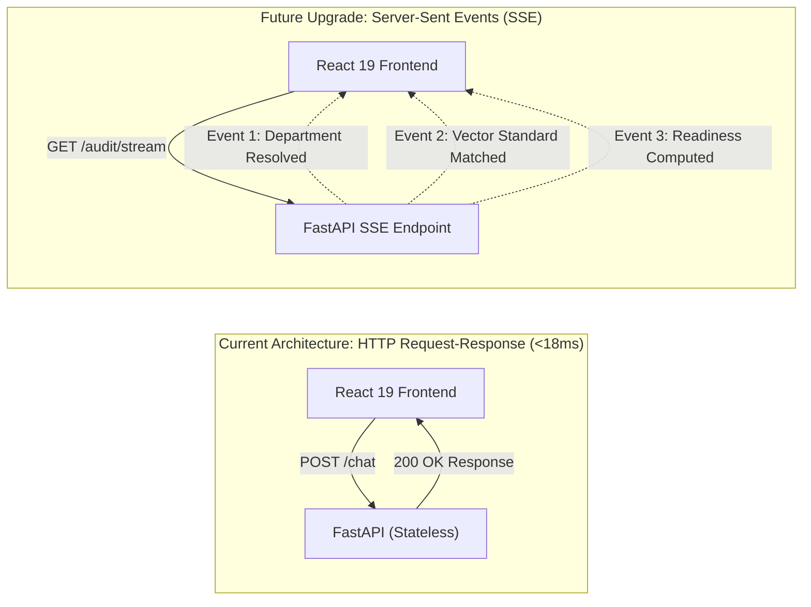

# 14.13 Real-Time Systems & Push Transports

## 1. What It Is in Plain Words
Real-time systems provide instant, bi-directional, event-driven data delivery between client browsers and servers without requiring manual page refreshes, using technologies like WebSockets, Server-Sent Events (SSE), or HTTP Long Polling.

---

## 2. How THIS Project Uses It
- **Current Transport**: **Stateless Request-Response over HTTP/1.1**. Because the entire compliance determination completes in ~16ms, real-time push transports are **Not Used** in the current release.
- **Why It Was a Reasonable Decision**: For a sub-20ms transactional API, opening and maintaining persistent WebSocket connections adds significant state management, heartbeat tracking, and socket memory overhead without perceptible user benefit [CONFIRM WITH DEVELOPER].



---

## 3. Comparison of Real-Time Transport Protocols
| Transport | Directionality | Protocol | Connection Overhead | Reconnection | Fit for This Engine |
| :--- | :--- | :--- | :--- | :--- | :--- |
| **HTTP Request-Response** (Used) | Unidirectional (Client Pull) | Standard HTTP/1.1 | **Minimal (Closed or Keep-Alive)** | Native | **Optimal for <20ms queries** |
| **Server-Sent Events (SSE)** | Unidirectional (Server Push) | Standard HTTP (Streaming) | Low (Single HTTP connection) | Built-in browser retry | Best for multi-step audit updates |
| **WebSockets** | Full Duplex (Bi-directional) | TCP (ws:// / wss://) | High (Stateful persistent socket) | Manual heartbeat/reconnect | Overkill (No client push needed) |
| **HTTP Long Polling** | Emulated Push | Repeated HTTP calls | High (Repeated TCP handshakes) | Manual loop | Obsolete |

---

## 4. Trade-offs Accepted
- **No Progress Indicators**: During the brief 16ms processing window, the client sees a static loading spinner rather than progressive milestone updates.

---

## 5. What Breaks at Scale
- **At 10x Load**: HTTP request-response continues to perform cleanly.
- **At 100x Load**: Remains stable; no socket connection limits exist.
- **At 1000x Load**: If large batch audits (e.g., auditing 500 factory components at once) are added, a synchronous HTTP connection could time out if processing takes longer than 30 seconds.

---

## 6. How a Senior Engineer Would Improve It
For multi-standard batch audits or live regulatory surveillance streaming, introduce **Server-Sent Events (SSE)** via FastAPI's `StreamingResponse`:
```python
@app.get("/audit/stream")
async def stream_audit(query: str):
    async def event_generator():
        yield "data: {\"step\": \"classifying_department\"}\n\n"
        # ... compute embedding ...
        yield "data: {\"step\": \"standard_resolved\", \"standard\": \"IS 12269\"}\n\n"
    return StreamingResponse(event_generator(), media_type="text/event-stream")
```

---

## 7. 30-Second Spoken Answer
> "We intentionally avoided WebSockets because our entire inference pipeline finishes in sixteen milliseconds—establishing and maintaining persistent bi-directional socket connections would add unnecessary memory and heartbeat overhead. If we implement bulk batch audits or multi-document OCR in the future, we would use Server-Sent Events over standard HTTP for progressive progress updates."
