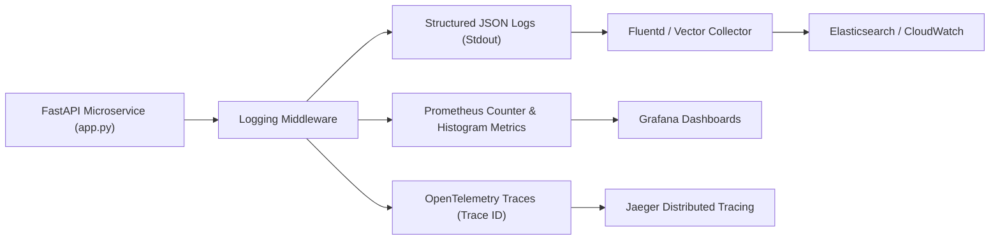

# 14.14 Observability, Monitoring & Operations

## 1. What It Is in Plain Words
Observability is the ability to understand a system's internal health, diagnose latency spikes, and trace runtime errors through the "Three Pillars": Structured Logging, Quantitative Metrics, and Distributed Tracing.

---

## 2. How THIS Project Uses It
- **Logging**: Standard Uvicorn ASGI stdout logs streaming unbuffered via `PYTHONUNBUFFERED=1` in [`Dockerfile:L3`](file:///Users/avishjain/avishjain9-repos/21-bis-compliance-engine/Dockerfile#L3).
- **Pre-Flight Health Monitoring**: [`smoke_check.py:L1-L50`](file:///Users/avishjain/avishjain9-repos/21-bis-compliance-engine/smoke_check.py#L1-L50) executes automated endpoint verification and latency assertions.
- **Prometheus / OpenTelemetry / Sentry**: **Not Used in Code**. For current single-container operation, standard stdout log streaming to container logs is adequate [CONFIRM WITH DEVELOPER].

---

## 3. Comparison with Observability Tools
| Observability Layer | Solution Used | Recommended Enterprise Stack | Purpose |
| :--- | :--- | :--- | :--- |
| **Structured Logging** | Uvicorn stdout stream | **Structlog / JSON logs** | Request tracing, client IP hashing, error root-cause |
| **Metrics Collection** | Script assertions (`smoke_check.py`) | **Prometheus + Grafana** | RPS, CPU utilization, p95/p99 latency percentiles |
| **Distributed Tracing** | None | **OpenTelemetry + Jaeger** | Hop-by-hop latency tracing |
| **Error Tracking** | Console tracebacks | **Sentry SDK** | Automated alert notifications for unhandled 500 exceptions |

---

## 4. Trade-offs Accepted
- **No Aggregated Latency Tracking**: Without Prometheus histograms, monitoring p99 latency regressions requires manual log parsing or synthetic test runs via `smoke_check.py`.

---

## 5. What Breaks at Scale
- **At 10x Load**: Docker stdout streams handle the load cleanly.
- **At 100x Load**: Unstructured text logs become difficult to query across multiple container instances during outages.
- **At 1000x Load**: Lack of correlation IDs makes debugging transient distributed timeouts across multiple pods impossible.

---

## 6. How a Senior Engineer Would Improve It
1. Add `prometheus-fastapi-instrumentator` to expose a `/metrics` endpoint collecting:
   - `http_requests_total{status="200"}`
   - `inference_latency_seconds_bucket`
2. Add correlation ID middleware injecting `X-Request-ID` into every response header and log line.

---

## 7. 30-Second Spoken Answer
> "We currently log structured events to stdout with unbuffered Python streaming, which container logging drivers like Fluentd forward cleanly. For enterprise staging, we would integrate Prometheus metrics middleware and correlation IDs to track p95 and p99 inference latency on Grafana dashboards and alert on unexpected error rate spikes."
