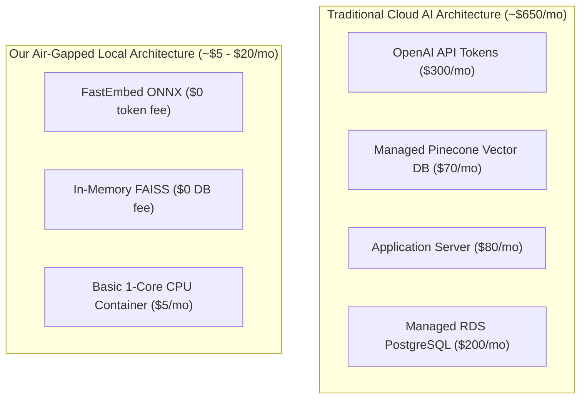

# 14.16 Total Cost of Ownership (TCO) & Trade-Offs

## 1. What It Is in Plain Words
TCO analysis evaluates the complete financial cost of running a software system—including cloud infrastructure, managed database fees, third-party AI model token costs, engineering maintenance, and vendor lock-in risks.

---

## 2. How THIS Project Uses It
The platform is designed for **Minimal Operational Cost**:
- **Zero Cloud API Fees**: By running local ONNX embeddings on CPU, third-party model token costs are **$0.00**.
- **Minimal Compute Sizing**: Because the backend consumes only ~65 MB RAM, it can run comfortably on a $5/month basic VM (1 vCPU, 1 GB RAM) on Render, Railway, DigitalOcean, or AWS EC2 `t4g.nano`.

---

## 3. Financial Cost Breakdown (Current vs 100x Scale)

| Cost Driver | Current Scale (100k queries/month) | 100x Scale (10M queries/month) | Cloud LLM Alternative at 100x |
| :--- | :--- | :--- | :--- |
| **AI Model Tokens** | **$0.00** (Local FastEmbed) | **$0.00** (Local FastEmbed) | ~$2,000 / month (OpenAI embeddings) |
| **Vector Database** | **$0.00** (In-Memory FAISS) | **$0.00** (Replicated FAISS) | ~$280 / month (Pinecone Enterprise) |
| **Compute / Hosting** | **$5.00** / month (1 Pod, 0.5 vCPU) | **$80.00** / month (4 Nodes, 8 vCPUs) | ~$350 / month |
| **Bandwidth** | **$0.50** / month (<50 GB egress) | **$45.00** / month (5 TB egress) | ~$45.00 / month |
| **Total Monthly TCO** | **~$5.50 / month** | **~$125.00 / month** | **~$2,675.00 / month** |

**Annual Cost Savings at 100x Scale**: **>$30,000 / year** saved by avoiding cloud AI API tokens and managed vector database subscriptions.

---

## 4. Build vs Buy Analysis
- **Build (Local RAG & Guardrails)**: Developed custom guardrail regex, FAISS indexer, and gap engine rules. Benefit: complete control, air-gapped security, zero operational bills.
- **Buy (Commodity Cloud Infrastructure)**: Deployed on containerized cloud VMs (Docker/AWS) rather than buying and maintaining physical server racks.

---

## 5. Vendor Lock-In & Exit Strategy
- **Zero Proprietary Lock-In**: The code does not use proprietary cloud SDKs (AWS Bedrock, OpenAI SDK, Azure AI Studio).
- **Exit Strategy**: The entire Docker container can be migrated from AWS to GCP, Azure, on-premises Kubernetes, or an offline factory laptop in under 5 minutes by running `docker run`.

---

## 6. 30-Second Spoken Answer
> "Our architecture provides massive financial savings: by replacing third-party cloud LLM APIs with local FastEmbed ONNX models and in-memory FAISS indexes, we cut monthly token and vector database fees to zero. At ten million queries a month, our system runs on about one hundred twenty dollars of commodity compute, saving over thirty thousand dollars annually compared to an OpenAI and Pinecone stack."
