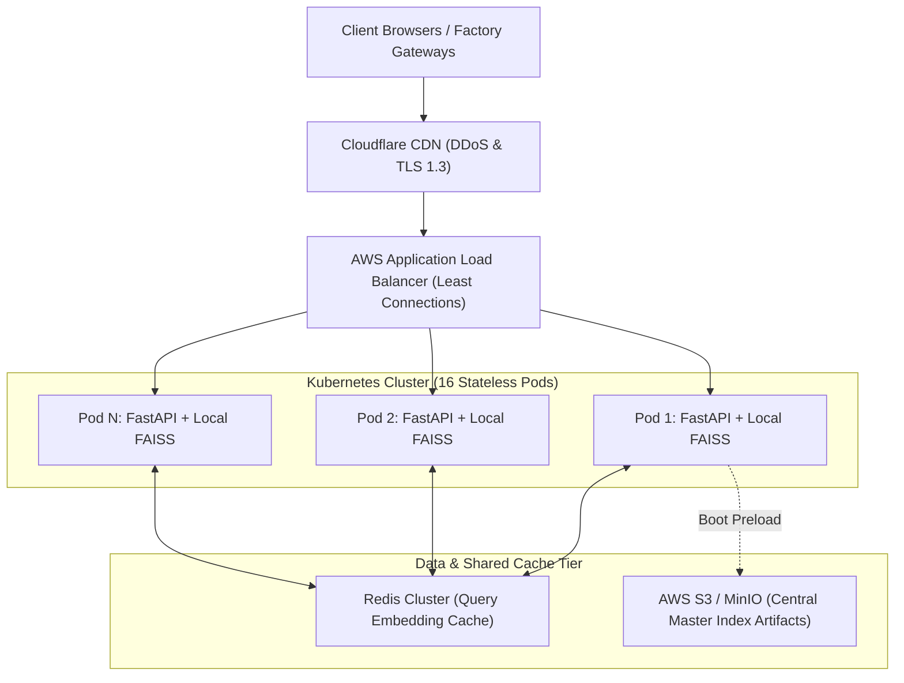
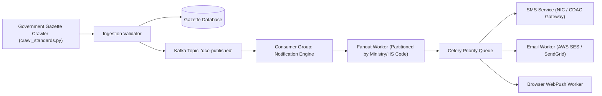
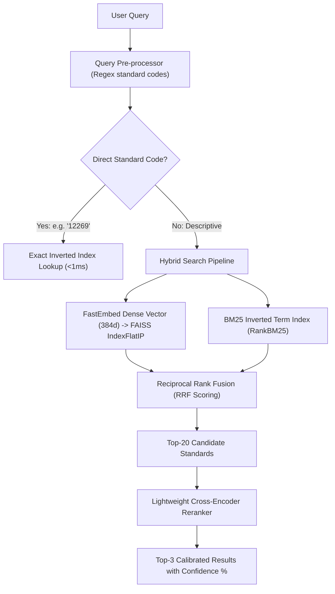
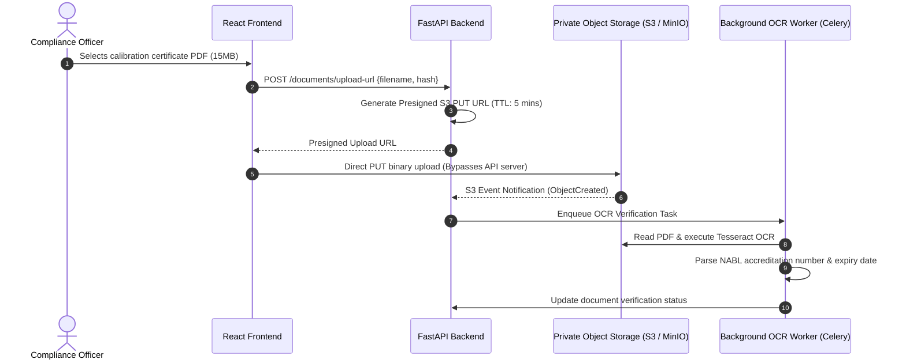
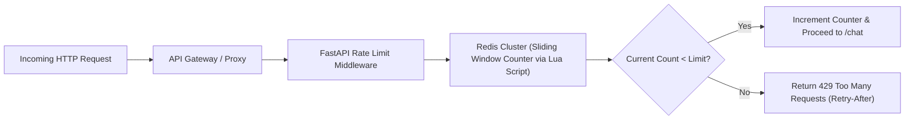

# 14.17 Classic System Design Problems Applied to This Project

This document provides full interview-style system designs applying the architectural building blocks of the **21-BIS-Compliance-Engine** to core distributed systems problems.

---

## 1. Design This Project at 100x Scale (7,500 RPS)

### Requirements & Estimation
- **Functional**: Sub-50ms statutory standard identification and gap analysis for 10 million audits/month; 7,500 peak queries/sec.
- **Non-Functional**: 99.99% availability, zero cloud token costs, strict data privacy.
- **Compute Sizing**: 7,500 RPS $\times$ 14ms compute $= 105$ dedicated CPU cores. Distributed across 16 Kubernetes nodes (8 cores each).

### Architecture Diagram

### Deep Dive & Bottlenecks
- **Embedding Cache**: 70% of factory queries target the top 500 mandatory standards (cement, steel, cables). Redis cluster caches the 384-dimensional float arrays for these queries, eliminating ONNX computation for 5,250 of the 7,500 RPS.
- **Index Distribution**: Master FAISS index updates are published to S3; pods poll S3 or receive an event hook to atomically reload memory pointers without downtime.

---

## 2. Design the Regulatory Gazette Notification System

### Requirements & Estimation
- **Functional**: Notify compliance officers via Email, SMS, and WhatsApp when new Quality Control Orders (QCOs) or gazette amendments are published.
- **Volume**: 500,000 subscribed manufacturers across India; 5-10 gazettes published monthly.

### Architecture Diagram

### Deep Dive
- **Fanout & Deduplication**: To avoid spamming, the fanout worker queries subscribed product categories (e.g., users registered for "Civil Engineering & Cement") and enqueues notification payloads with idempotency keys (`gazette_id:user_id`).

---

## 3. Design the Semantic Search System (20,000 Standards)

### Requirements & Estimation
- **Functional**: Search over 20,000 national standards with typo tolerance, synonym resolution, and sub-10ms response times.
- **Storage**: 20,000 records $\approx 30$ MB FAISS index; 25 MB inverted BM25 text index.

### Architecture Diagram

---

## 4. Design the Factory Certificate & Document Upload System

### Requirements & Estimation
- **Functional**: Secure upload of 25MB NABL calibration and factory layout PDFs; automatic OCR verification.
- **Security**: Antivirus scanning, cryptographic HMAC signing, presigned URLs.

### Architecture Diagram

---

## 5. Design a Rate Limiter for Regulatory AI Queries

### Requirements & Estimation
- **Functional**: Enforce sliding window limits (30 req/min per IP; 500 req/min per enterprise API key).
- **Scale**: Sub-millisecond evaluation across 10,000 concurrent IPs.

### Architecture Diagram

---

## 6. Reusing Stack Building Blocks for Classic Applications

| Classic Problem | How Our Stack's Components Are Reused |
| :--- | :--- |
| **URL Shortener** | FastAPI route handling; Base62 encoding; in-memory / Redis key-value lookup returning HTTP 302 redirects. |
| **Chat System** | React frontend chat stream; FastAPI ASGI WebSocket connections; local intent classifier for bot automation. |
| **News Feed** | Master JSON corpus pattern representing feed items; FAISS vector index matching user interest vectors to article embeddings. |
| **Real-Time Collaboration** | React state management; FastAPI WebSockets with Redis Pub/Sub backplane broadcasting document edits. |
