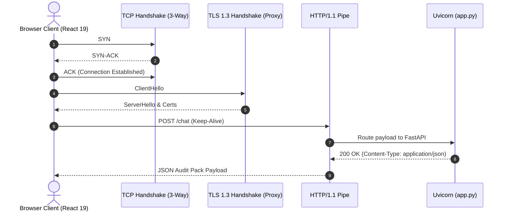

# 14.3 Networking & Communication Protocols

## 1. What It Is in Plain Words
Networking and communication protocols govern how data moves between clients and servers across physical networks—covering transport layers (TCP/UDP), application standards (HTTP/1.1 vs HTTP/2 vs gRPC), and message serialization formats (JSON, Protobuf, CSV).

---

## 2. How THIS Project Uses It
- **Application Protocol**: HTTP/1.1 over TCP via Uvicorn ([`Dockerfile:L15`](file:///Users/avishjain/avishjain9-repos/21-bis-compliance-engine/Dockerfile#L15)).
- **Data Serialization**:
  - `POST /chat`: JSON request and response payloads validated via Pydantic ([`app.py:L61,L74`](file:///Users/avishjain/avishjain9-repos/21-bis-compliance-engine/app.py#L61)).
  - `POST /audit/export`: `text/csv` stream with `Content-Disposition` attachment header ([`app.py:L148-L151`](file:///Users/avishjain/avishjain9-repos/21-bis-compliance-engine/app.py#L148-L151)).
- **CORS Handling**: Permissive wildcard `allow_origins=["*"]` configured via `CORSMiddleware` ([`app.py:L18`](file:///Users/avishjain/avishjain9-repos/21-bis-compliance-engine/app.py#L18)).

---

## 3. Comparison with Alternatives
| Protocol | Transport | Multiplexing | Payload Format | Streaming Support | Fit for This Engine |
| :--- | :--- | :--- | :--- | :--- | :--- |
| **REST over HTTP/1.1** (Used) | TCP | Head-of-Line Blocking | JSON / CSV Text | Chunked Transfer | **Optimal (Universal browser client support)** |
| **HTTP/2** | TCP | Binary Multiplexing | JSON / Binary | Native Streams | Recommended for production proxy |
| **gRPC** | HTTP/2 | High Multiplexing | Protocol Buffers | Bi-directional | Overkill for browser clients |
| **WebSockets** | TCP (Upgraded) | Full Duplex | Text / Binary Frames | Continuous | Not needed (No streaming chat) |

---

## 4. Trade-offs Accepted
- **HTTP/1.1 Head-of-Line Blocking**: Sequential requests over a single TCP connection must wait for preceding requests to finish, causing minor latency queuing during rapid parallel burst queries.
- **JSON Text Overhead**: JSON serialization incurs ~15% higher byte size compared to binary formats like Protocol Buffers or MessagePack.

---

## 5. What Breaks at Scale
- **At 10x Load**: Standard TCP connection reuse via HTTP Keep-Alive handles the load without packet drops.
- **At 100x Load**: TCP socket exhaustion (TIME_WAIT saturation) can occur if clients open and close connections rapidly rather than reusing connections.
- **At 1000x Load**: HTTP/1.1 connection limits throttle throughput; requires an HTTP/2 or HTTP/3 reverse proxy (Nginx or Cloudflare) to multiplex thousands of streams over single TCP/QUIC connections.

---

## 6. How a Senior Engineer Would Improve It
Place the backend behind an **Nginx reverse proxy** terminating **HTTP/2 with TLS 1.3**, enabling single-connection multiplexing, gzip/Brotli payload compression, and strict CORS origin headers.

---

## 7. 30-Second Spoken Answer
> "We use standard REST over HTTP/1.1 with JSON payloads and CSV streaming because it provides universal, zero-friction compatibility with browser clients and ERP export systems. For production scale, placing the service behind an Nginx proxy terminating HTTP/2 provides binary multiplexing and connection reuse with zero application code changes."
