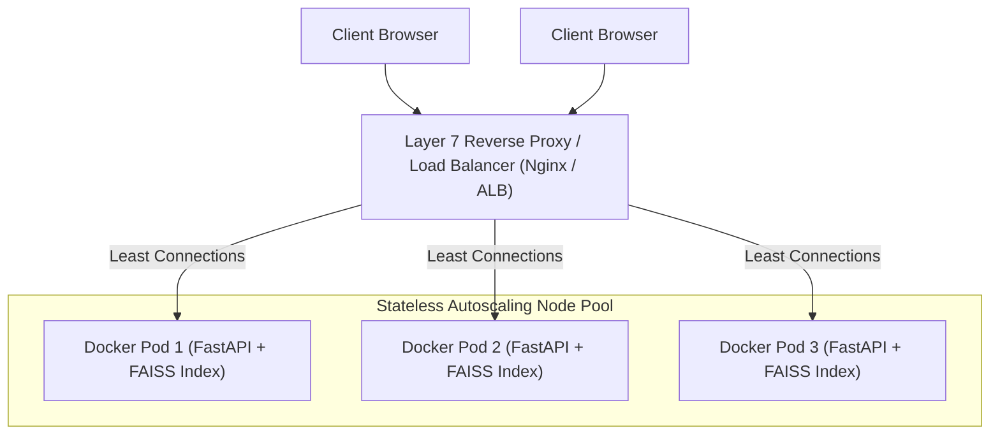

# 14.4 Load Balancing & Scaling Strategy

## 1. What It Is in Plain Words
Load balancing distributes incoming client network requests evenly across multiple backend server instances to prevent individual server crashes, eliminate single points of failure (SPOFs), and achieve horizontal scale.

---

## 2. How THIS Project Uses It
The backend application in [`app.py`](file:///Users/avishjain/avishjain9-repos/21-bis-compliance-engine/app.py) is architected to be **100% stateless**:
- **Stateless Handlers**: No user sessions, in-memory counters, or temporary transaction states are stored across requests.
- **Shared Read-Only Memory**: The vector index and corpus are static read-only files loaded at boot.
- **Horizontal Scale Ready**: Any number of identical Docker containers can be spun up side-by-side behind a round-robin load balancer without requiring sticky sessions or distributed session stores.

---

## 3. Comparison of Load Balancing Algorithms
| Algorithm | Mechanism | Best Use Case | Fit for This Engine |
| :--- | :--- | :--- | :--- |
| **Least Connections** | Routes to node with fewest active requests | Variable execution times | **Optimal (Handles variance between small talk & ONNX embedding)** |
| **Round Robin** | Sequential cyclic distribution | Uniform short requests | Acceptable baseline |
| **IP Hash** | Hashes client IP to fixed node | Sticky session requirements | Not needed (Stateless) |
| **Weighted Round Robin** | Allocates higher traffic to more powerful servers | Heterogeneous hardware | Useful in mixed CPU clusters |

---

## 4. Trade-offs Accepted
- **Duplicated Memory**: Because FAISS runs in-memory, running 10 horizontal container instances replicates the 65 MB index 10 times (totaling 650 MB RAM). Given low hardware costs, this trade-off is vastly preferable to managing a separate centralized vector database cluster.

---

## 5. What Breaks at Scale
- **At 10x Load**: A single instance scales vertically up to 4 CPU workers cleanly.
- **At 100x Load**: Single instance saturates; requires spinning up 8-12 container replicas behind an AWS Application Load Balancer or Nginx.
- **At 1000x Load**: If updating the corpus, synchronizing new FAISS index files across 100 running container instances requires rolling blue-green deployments or mounting index files from a shared distributed read-only network volume (EFS).

---

## 6. How a Senior Engineer Would Improve It
Deploy on **Kubernetes (EKS / GKE)** with a **Horizontal Pod Autoscaler (HPA)** configured with metrics:
- Metric: Average CPU utilization $>70\%$.
- Health Probe: HTTP `GET /` liveness and readiness probe checked every 5 seconds.
- Zero-Downtime: Rolling updates with `maxSurge: 25%` and `maxUnavailable: 0`.

---

## 7. 30-Second Spoken Answer
> "Our application is architected to be completely stateless: the vector index and corpus are immutable read-only structures in resident RAM. Because no session state exists on the server, we can scale horizontally to dozens of container instances behind an AWS Application Load Balancer using a Least Connections algorithm with zero sticky session complexity."
