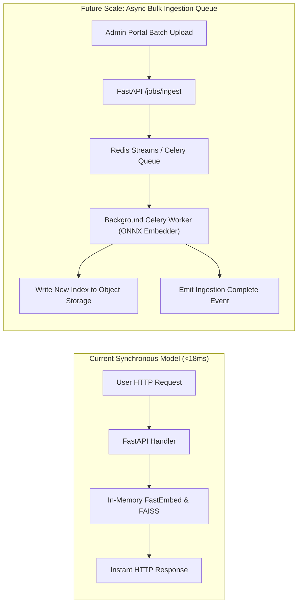

# 14.7 Messaging, Queues & Asynchronous Processing

## 1. What It Is in Plain Words
Message queues and asynchronous task workers decouple long-running, compute-heavy jobs (like web scraping, bulk document indexing, or PDF report rendering) from synchronous HTTP request-response cycles, preventing web servers from timing out.

---

## 2. How THIS Project Uses It
- **Synchronous Execution**: The current request pipeline in [`app.py`](file:///Users/avishjain/avishjain9-repos/21-bis-compliance-engine/app.py) executes **synchronously** within the request handler because inference completes in under 18ms.
- **Offline Batch Processing**: Heavy tasks like bulk corpus merging and FAISS index rebuilding are executed offline via standalone Python scripts ([`bulk_ingest.py`](file:///Users/avishjain/avishjain9-repos/21-bis-compliance-engine/bulk_ingest.py), [`merge_corpus.py`](file:///Users/avishjain/avishjain9-repos/21-bis-compliance-engine/merge_corpus.py), [`rebuild_faiss_index.py`](file:///Users/avishjain/avishjain9-repos/21-bis-compliance-engine/rebuild_faiss_index.py)).
- **Queues (Kafka / RabbitMQ / Celery)**: **Not Used**. Given sub-20ms latencies, integrating an external message broker would add unnecessary infrastructure complexity [CONFIRM WITH DEVELOPER].

---

## 3. Comparison with Messaging Alternatives
| Technology | Paradigm | Latency Overhead | Delivery Guarantees | Ordering | Fit for This Engine |
| :--- | :--- | :--- | :--- | :--- | :--- |
| **Direct Synchronous** (Used) | Request-Response | **0.00 ms** | Exact (In-thread) | Strict | **Optimal for <20ms inference** |
| **Celery + Redis** | Task Queue | ~10 - 25 ms | At-least-once | FIFO per queue | Best for future bulk file OCR |
| **RabbitMQ** | Message Broker | ~3 - 8 ms | At-least-once / AMQP | Strict FIFO | Overkill for simple tasks |
| **Apache Kafka** | Distributed Event Log | ~15 - 40 ms | Exactly-once (Transactional) | Partition Order | Extreme overkill |

---

## 4. Trade-offs Accepted
- **Coupled Ingestion**: Adding 5,000 new standards cannot be done through the live REST API without momentarily blocking CPU threads; it requires running `rebuild_faiss_index.py` offline and reloading the container.

---

## 5. What Breaks at Scale
- **At 10x Load**: Synchronous processing handles the load cleanly without queueing.
- **At 100x Load**: If large batch CSV exports (10,000 rows) or multi-megabyte PDF certificate uploads are added, the synchronous HTTP thread pool will starve.
- **At 1000x Load**: Any heavy background task execution inside the web process causes catastrophic HTTP request dropouts.

---

## 6. How a Senior Engineer Would Improve It
Introduce **Celery with Redis** for asynchronous job offloading:
- The user uploads a 50-page PDF audit dossier.
- API instantly responds with `202 Accepted` and a `job_id`.
- Background Celery workers execute OCR and vector extraction.
- Client polls `GET /jobs/{id}` or receives a WebSocket completion notification.

---

## 7. 30-Second Spoken Answer
> "We intentionally omitted message queues like Celery or Kafka because our end-to-end inference completes in under eighteen milliseconds, well below standard web timeouts. Adding a message queue would introduce unnecessary polling complexity for users; however, if we introduce heavy OCR parsing of fifty-page audit PDFs in the future, we would offload that processing to Celery workers over Redis."
