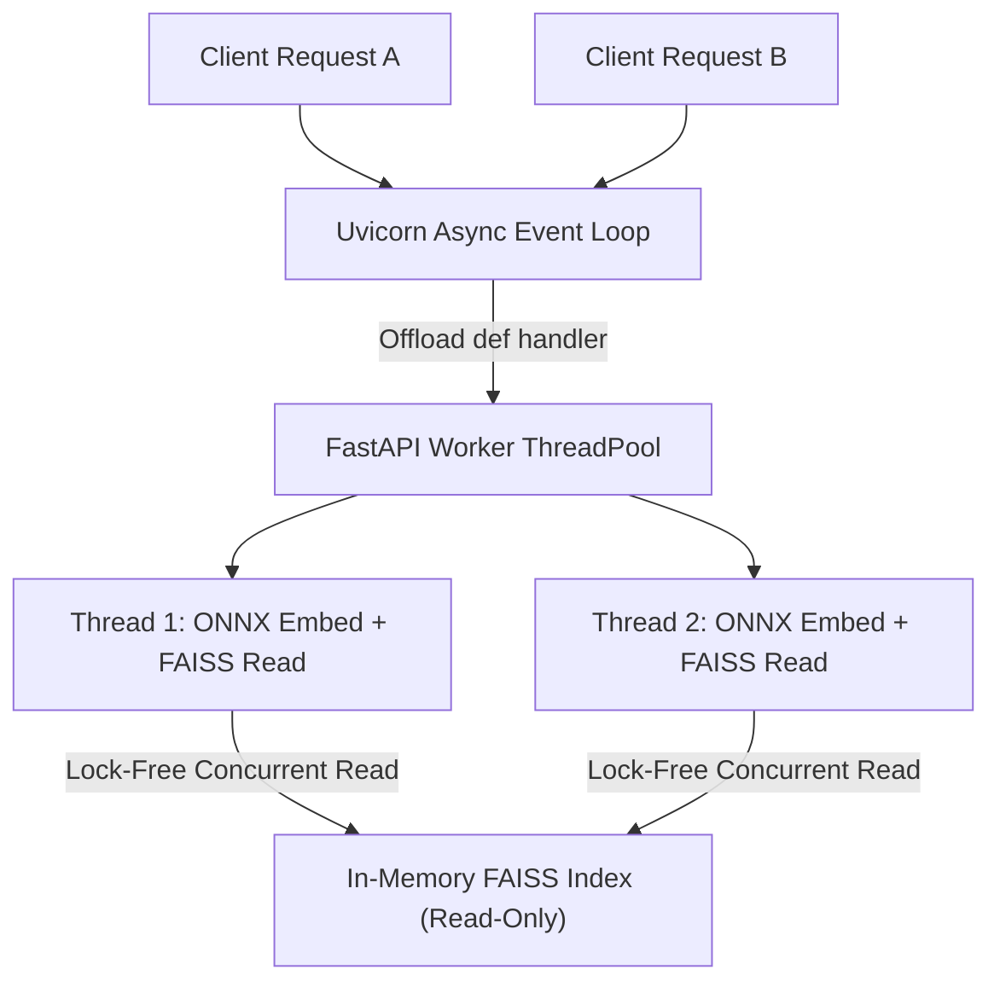

# 14.8 Concurrency, Consistency & Distributed Systems

## 1. What It Is in Plain Words
Concurrency manages how many tasks execute simultaneously without interfering with one another; consistency ensures that all clients see identical, accurate data regardless of which server or node answers their query.

---

## 2. How THIS Project Uses It
- **Thread Concurrency Model**: Uvicorn runs an asynchronous `asyncio` event loop. Because the route handlers (`chat_endpoint` and `export_audit`) are defined as standard `def` functions rather than `async def` ([`app.py:L74,L141`](file:///Users/avishjain/avishjain9-repos/21-bis-compliance-engine/app.py#L74)), FastAPI automatically offloads them to an internal threadpool (`anyio`), preventing CPU-bound vector math from starving the event loop.
- **Data Consistency Model**: **Strict Read-Only Consistency**. The vector index and corpus are static, immutable files loaded once at boot. Because no concurrent write mutations take place during runtime, the system is fundamentally immune to race conditions, deadlocks, and dirty reads.



---

## 3. Comparison with Concurrency Models
| Concurrency Strategy | Memory Isolation | GIL Impact | Thread Overhead | Race Condition Risk | Fit for This Engine |
| :--- | :--- | :--- | :--- | :--- | :--- |
| **FastAPI ThreadPool (AnyIO)** (Used) | Shared Process Memory | Bound by GIL for pure Python | Moderate (~100 threads) | **Zero (Read-only data)** | **Optimal** |
| **ProcessPoolExecutor** | Separate Address Space | Completely bypasses GIL | High (Duplicate model memory) | Zero | Good for multi-core saturation |
| **Go Goroutines** | Shared Heap + Channels | No GIL | Extremely Low (2 KB stack) | Low | Language switch required |
| **Node.js Worker Threads** | Isolated Contexts | Single-threaded event loop | Moderate | Low | Poor ML ecosystem |

---

## 4. Trade-offs Accepted
- **Python GIL (Global Interpreter Lock)**: While C++ FAISS code releases the GIL during search, pure Python execution (Pydantic parsing, guardrail regex, and gap engine loops) is serialized across threads within a single Python process.

---

## 5. What Breaks at Scale
- **At 10x Load**: Handled smoothly by thread pool concurrency.
- **At 100x Load**: GIL lock contention begins degrading throughput when multiple threads compete for CPU time on a single process.
- **At 1000x Load**: Requires running multiple independent OS worker processes via Uvicorn `--workers N` or Docker container replicas to saturate all CPU cores across nodes.

---

## 6. How a Senior Engineer Would Improve It
Launch Uvicorn with a worker process per CPU core:
```bash
uvicorn app:app --host 0.0.0.0 --port 8000 --workers $(nproc)
```
Each worker process operates its own independent Python runtime, completely bypassing the GIL and scaling throughput linearly with CPU cores.

---

## 7. 30-Second Spoken Answer
> "Because our application is strictly read-only during runtime, we achieve lock-free concurrent vector searches across threads without race condition risks. FastAPI automatically offloads our synchronous handlers to background threadpools so the event loop stays responsive, and running Uvicorn with multiple worker processes completely bypasses the Python GIL to scale linearly across CPU cores."
