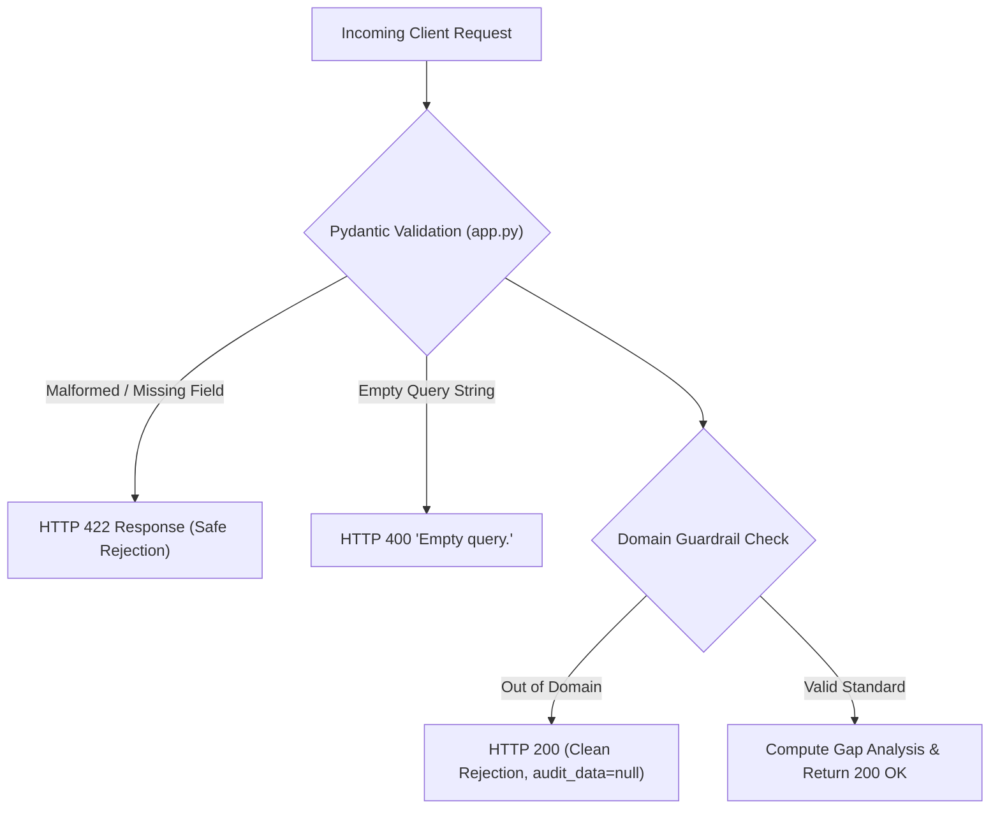

# 14.9 Reliability, Resilience & Fault Tolerance

## 1. What It Is in Plain Words
Reliability is the ability of a system to remain continuously operational and return accurate, timely responses despite hardware crashes, unexpected software exceptions, network drops, or malicious inputs.

---

## 2. How THIS Project Uses It
- **Input Validation Sanitization**: Pydantic v2 schemas reject malformed inputs before reaching business logic ([`app.py:L61-L67`](file:///Users/avishjain/avishjain9-repos/21-bis-compliance-engine/app.py#L61-L67)).
- **Liveness & Health Probe**: Dedicated `GET /` endpoint returning service status ([`app.py:L69-L71`](file:///Users/avishjain/avishjain9-repos/21-bis-compliance-engine/app.py#L69-L71)).
- **Graceful Error Degradation**: If Scikit-Learn predicts an unexpected label, it falls back gracefully to `"General Compliance"` ([`app.py:L86-L87`](file:///Users/avishjain/avishjain9-repos/21-bis-compliance-engine/app.py#L86-L87)); if a query fails domain guardrails, it returns a polite explanation rather than throwing an unhandled HTTP 500 error ([`app.py:L96-L99`](file:///Users/avishjain/avishjain9-repos/21-bis-compliance-engine/app.py#L96-L99)).
- **Circuit Breakers / Retries**: **Not Used**. The backend makes **zero outbound network calls**, meaning external network timeouts cannot occur.

---

## 3. Comparison with Reliability Patterns
| Pattern | Mechanism | Relevance to This Engine | Status in Codebase |
| :--- | :--- | :--- | :--- |
| **Defensive Input Validation** | Strict schema boundaries via Pydantic | Critical for web security | **Implemented** ([`app.py:L61`](file:///Users/avishjain/avishjain9-repos/21-bis-compliance-engine/app.py#L61)) |
| **Safe Fallbacks** | Defaulting unknown classes to safe strings | Prevents unhandled exceptions | **Implemented** ([`app.py:L87`](file:///Users/avishjain/avishjain9-repos/21-bis-compliance-engine/app.py#L87)) |
| **Health Probes** | Endpoint for orchestrator liveness checks | Critical for zero-downtime | **Implemented** ([`app.py:L69`](file:///Users/avishjain/avishjain9-repos/21-bis-compliance-engine/app.py#L69)) |
| **Circuit Breaker (Resilience4j/PyBreaker)** | Tripping requests to failing external APIs | N/A (Zero external network calls) | Not Applicable |
| **Exponential Backoff Retries** | Retrying transient network failures | N/A (Local in-memory search) | Not Applicable |

---

## 4. Trade-offs Accepted
- **In-Memory Volatility**: If the server process crashes due to an out-of-memory error, all active connections drop. This requires an external process supervisor (Docker or Kubernetes) with an automated restart policy (`restart: always`).

---

## 5. What Breaks at Scale
- **At 10x Load**: Docker restart policies easily handle isolated process restarts within 1.5 seconds.
- **At 100x Load**: If multiple pods restart simultaneously during a deployment, request queues drop.
- **At 1000x Load**: Requires a multi-region deployment with global DNS failover (Route 53) to guarantee 99.99% availability (Four Nines).

---

## 6. How a Senior Engineer Would Improve It
1. Configure **Kubernetes Pod Disruption Budgets (PDB)** ensuring at least 2 replica pods remain online during cluster upgrades.
2. Add structured exception handling middleware that catches unexpected runtime panics and returns standardized JSON error envelopes with tracking IDs.

---

## 7. 30-Second Spoken Answer
> "Our architecture achieves high reliability because it makes zero outbound network calls, completely eliminating the cascading failures, timeouts, and circuit breaker requirements of cloud-dependent microservices. Input sanitization is strictly enforced by Pydantic, unclassified intents gracefully fall back to default compliance categories, and Kubernetes health probes monitor the service for automatic instant restarts."
