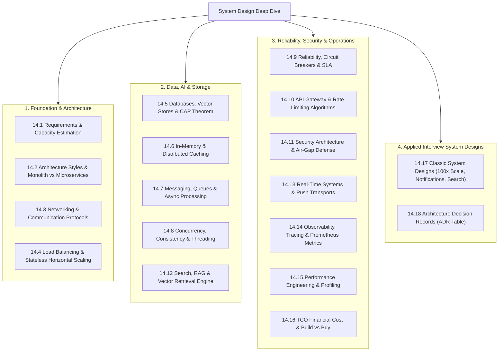

# System Design Deep Dive: Architectural Syllabus & Overview

This comprehensive 19-part system design syllabus evaluates the **21-BIS-Compliance-Engine** from an enterprise distributed systems perspective. Every topic covers what it is, how this project implements it, an alternatives matrix, what breaks at 10x/100x/1000x scale, how a senior engineer would redesign it, a dedicated Mermaid diagram, and a 30-second spoken interview response.

---

## Complete Table of Topics

| Section | Topic | Core Focus | Link |
| :--- | :--- | :--- | :--- |
| **14.1** | [Requirements & Estimation](file:///Users/avishjain/avishjain9-repos/21-bis-compliance-engine/docs/system-design/14.1-requirements-and-estimation.md) | Functional/Non-functional requirements, RPS, memory, bandwidth arithmetic | [View](file:///Users/avishjain/avishjain9-repos/21-bis-compliance-engine/docs/system-design/14.1-requirements-and-estimation.md) |
| **14.2** | [Architecture Styles](file:///Users/avishjain/avishjain9-repos/21-bis-compliance-engine/docs/system-design/14.2-architecture-styles.md) | Modular Monolith vs Microservices vs Serverless | [View](file:///Users/avishjain/avishjain9-repos/21-bis-compliance-engine/docs/system-design/14.2-architecture-styles.md) |
| **14.3** | [Networking & Communication](file:///Users/avishjain/avishjain9-repos/21-bis-compliance-engine/docs/system-design/14.3-networking-and-communication.md) | HTTP/1.1 vs HTTP/2, REST vs gRPC, DNS, TLS termination | [View](file:///Users/avishjain/avishjain9-repos/21-bis-compliance-engine/docs/system-design/14.3-networking-and-communication.md) |
| **14.4** | [Load Balancing & Scaling](file:///Users/avishjain/avishjain9-repos/21-bis-compliance-engine/docs/system-design/14.4-load-balancing-and-scaling.md) | L4 vs L7 load balancing, sticky sessions, stateless scaling | [View](file:///Users/avishjain/avishjain9-repos/21-bis-compliance-engine/docs/system-design/14.4-load-balancing-and-scaling.md) |
| **14.5** | [Databases & Storage](file:///Users/avishjain/avishjain9-repos/21-bis-compliance-engine/docs/system-design/14.5-databases-and-storage.md) | In-Memory FAISS vs PostgreSQL vs MongoDB vs Pinecone | [View](file:///Users/avishjain/avishjain9-repos/21-bis-compliance-engine/docs/system-design/14.5-databases-and-storage.md) |
| **14.6** | [Caching](file:///Users/avishjain/avishjain9-repos/21-bis-compliance-engine/docs/system-design/14.6-caching.md) | Cache-aside, vector caching, Redis vs Memcached | [View](file:///Users/avishjain/avishjain9-repos/21-bis-compliance-engine/docs/system-design/14.6-caching.md) |
| **14.7** | [Messaging & Queues](file:///Users/avishjain/avishjain9-repos/21-bis-compliance-engine/docs/system-design/14.7-messaging-and-queues.md) | RabbitMQ, Kafka, BullMQ, asynchronous job processing | [View](file:///Users/avishjain/avishjain9-repos/21-bis-compliance-engine/docs/system-design/14.7-messaging-and-queues.md) |
| **14.8** | [Consistency & Concurrency](file:///Users/avishjain/avishjain9-repos/21-bis-compliance-engine/docs/system-design/14.8-consistency-and-concurrency.md) | Python GIL, thread pools, lock-free vector lookups | [View](file:///Users/avishjain/avishjain9-repos/21-bis-compliance-engine/docs/system-design/14.8-consistency-and-concurrency.md) |
| **14.9** | [Reliability & Resilience](file:///Users/avishjain/avishjain9-repos/21-bis-compliance-engine/docs/system-design/14.9-reliability-and-resilience.md) | Circuit breakers, health probes, graceful degradation | [View](file:///Users/avishjain/avishjain9-repos/21-bis-compliance-engine/docs/system-design/14.9-reliability-and-resilience.md) |
| **14.10** | [API Design & Rate Limiting](file:///Users/avishjain/avishjain9-repos/21-bis-compliance-engine/docs/system-design/14.10-api-design-and-rate-limiting.md) | Token bucket, sliding window, REST standards | [View](file:///Users/avishjain/avishjain9-repos/21-bis-compliance-engine/docs/system-design/14.10-api-design-and-rate-limiting.md) |
| **14.11** | [Security Architecture](file:///Users/avishjain/avishjain9-repos/21-bis-compliance-engine/docs/system-design/14.11-security-architecture.md) | Air-gapped defense, zero trust, CORS policy | [View](file:///Users/avishjain/avishjain9-repos/21-bis-compliance-engine/docs/system-design/14.11-security-architecture.md) |
| **14.12** | [Search & AI Architecture](file:///Users/avishjain/avishjain9-repos/21-bis-compliance-engine/docs/system-design/14.12-search-and-ai-architecture.md) | Dense vs sparse search, hybrid retrieval, FAISS vs BM25 | [View](file:///Users/avishjain/avishjain9-repos/21-bis-compliance-engine/docs/system-design/14.12-search-and-ai-architecture.md) |
| **14.13** | [Real-Time Systems](file:///Users/avishjain/avishjain9-repos/21-bis-compliance-engine/docs/system-design/14.13-real-time-systems.md) | WebSockets vs SSE vs Long Polling for live audits | [View](file:///Users/avishjain/avishjain9-repos/21-bis-compliance-engine/docs/system-design/14.13-real-time-systems.md) |
| **14.14** | [Observability & Operations](file:///Users/avishjain/avishjain9-repos/21-bis-compliance-engine/docs/system-design/14.14-observability-and-operations.md) | Metrics, logging, Prometheus, Grafana, OpenTelemetry | [View](file:///Users/avishjain/avishjain9-repos/21-bis-compliance-engine/docs/system-design/14.14-observability-and-operations.md) |
| **14.15** | [Performance Engineering](file:///Users/avishjain/avishjain9-repos/21-bis-compliance-engine/docs/system-design/14.15-performance-engineering.md) | Latency percentiles (p50/p95/p99), Little's Law, CPU profiling | [View](file:///Users/avishjain/avishjain9-repos/21-bis-compliance-engine/docs/system-design/14.15-performance-engineering.md) |
| **14.16** | [Cost & Trade-Offs](file:///Users/avishjain/avishjain9-repos/21-bis-compliance-engine/docs/system-design/14.16-cost-and-trade-offs.md) | TCO financial analysis: $0 cloud fees vs GPU servers | [View](file:///Users/avishjain/avishjain9-repos/21-bis-compliance-engine/docs/system-design/14.16-cost-and-trade-offs.md) |
| **14.17** | [Classic System Design Questions](file:///Users/avishjain/avishjain9-repos/21-bis-compliance-engine/docs/system-design/14.17-classic-system-design.md) | Scaling to 100x, Notification service, Search service | [View](file:///Users/avishjain/avishjain9-repos/21-bis-compliance-engine/docs/system-design/14.17-classic-system-design.md) |
| **14.18** | [Design Decisions Log (ADR)](file:///Users/avishjain/avishjain9-repos/21-bis-compliance-engine/docs/system-design/decisions.md) | Comprehensive table of all architecture decision records | [View](file:///Users/avishjain/avishjain9-repos/21-bis-compliance-engine/docs/system-design/decisions.md) |
